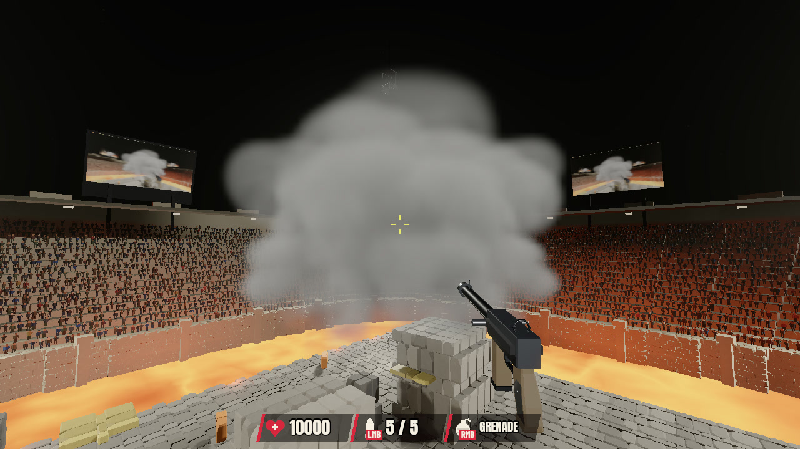

# Adaptive explosion smoke, 31 October 2026

Smoke now trades rendering detail for cost when a view contains large or
overlapping plumes. The decision is independent for each split-screen view,
so a player next to an explosion can use a cheaper layer while another player
looking across the arena retains more detail. The pre-baked motion and ordinary
4.6-second lifetime are unchanged.

## Quality and work limits

Each live visible smoke box contributes its conservative projected pixel area.
A box crossing the near plane counts as a whole view. The renderer chooses the
first tier whose projected pixel layers divided by the squared divisor fit
450,000 pixels, capped at the eighth-resolution tier:

| Soft-layer size on each axis | Maximum ray samples |
| --- | ---: |
| Full | 48 |
| Half | 40 |
| Quarter | 32 |
| Eighth | 24 |

Quality drops immediately when projected work increases. Recovery waits for
0.25 seconds below 65% of the next finer tier's threshold. Rewinds, large clock
jumps and resized targets reset this history. Empty views recover immediately.
This is a projected-work heuristic, not measured GPU-time feedback or a
universal frame-time limit. Conservative boxes can select a coarse tier for
thin or hidden smoke; the opaque depth test still clips the actual rays.

Smoke and soft fire remain sorted together in one premultiplied HDR layer.
Heat, embers, additive columns, streaks and motes stay at output resolution.
The composite uses scene depth to reject unrelated low-resolution neighbours.
Both passes use the same pixel-to-depth mapping, including odd target sizes,
to avoid sampling opposite sides of a foreground edge. A conservative depth
bound covers every live smoke/fire shape and its possible rise. When both
guides are beyond that entire layer, normal bilinear interpolation applies;
distant rails cannot cut holes through smoke in front of them. If interpolation rejects
all neighbours, a fallback may use the nearest depth that is equal or closer
than the output surface, which avoids gaps at steep continuous depth gradients.
If every neighbour is farther away, the composite omits that smoke sample; it
can leave a narrow gap in smoke in front of a thin object.

Conservative per-frame density supports also avoid empty parts of each volume.
Bounds are generated from the quantized asset with a one-voxel filter margin.
Adjacent animation frames use the union of their supports. The ray sample grid
stays aligned to the original cube, so changes in bounds do not move the
samples. These savings apply even with adaptive resolution disabled.

Up to 64 plumes remain active. Further arrivals retire the oldest active plume
over 0.30 seconds by fading density without retiming its animation. A hard
limit of 96 includes up to 32 retiring plumes. Extremely large same-tick bursts
prefer dropping new, still-empty plumes over deleting established smoke, but
this finite budget cannot preserve every explosion indefinitely. Sustained
rates above about 14/s can shorten tails; at 40/s the active history is about
1.6 seconds before retirement, compared with about 0.4 seconds previously.

The 6.75 MiB animation is still shared by all explosions. Each view lazily
caches half-, quarter- and eighth-resolution RGBA16F targets; all three tiers
across a 3840x2160 output add about 20.8 MiB (ignoring alignment). Resizing
replaces those targets. The layer is cleared every use, and no smoke is written
to temporal reconstruction history.

`WARP_SMOKE_QUALITY=full` disables adaptive resolution and sample reduction for
diagnosis; it retains tight bounds and the revised volume budget.
`Renderer::smoke_quality_stats()` reports the last per-view divisor, ray count,
soft size, projected pixel layers and visible volume-box count. It does not
report GPU time or count density visible through occluders. Low/minimum Growing
Guns profiles continue using the original billows.

## Measurement and review

The [measurement data](data/adaptive-smoke-20261031.json) records an NVIDIA
GeForce RTX 5070 Ti, Vulkan, native Windows/MSVC development build (workspace
opt-level 1, dependencies 3). Runs were headless and serial, without a concurrent
game or compilation. The table reports median GPU time for the complete FX
pass, summed across four views in one native 3840x2160 output. These are not
presented FPS or four-player 120 Hz acceptance results.

| Workload | Historical fixed resolution | Current forced full | Current adaptive |
| --- | ---: | ---: | ---: |
| 16 overlapping radius-6.5 m blasts, cameras inside, age 0.85 s | 33.002 ms | 22.859 ms | 0.508 ms |
| 64 overlapping radius-6.5 m blasts, cameras inside, age 0.85 s | Not measured | 92.364 ms | 1.135 ms |
| 16 radius-6.5 m blasts, cameras inside, late tail at 4.3 s | 33.000 ms | 24.728 ms | 0.535 ms |
| 16 radius-30 m blasts, cameras inside, age 0.85 s | 48.403 ms | Not measured | 1.480 ms |
| Real-game stress: 40 explosions/s, four overhead views | 2.818 ms | Not measured | 0.725 ms |

The isolated probes use the actual explosion recipe and lights in a floor-only
scene, with 12 warmup frames and 24 timestamp samples per case. Startup, asset
upload and image readback are excluded. All adaptive inside cases above select the
eighth-resolution tier. The current forced-full run retains the new bounds and
volume budget, isolating the adaptive resolution/sample savings. The full-resolution path bypasses the adaptive composite and depth-bound scan.
The [historical baseline](log/baked-smoke-scaling.md) retained only 16 smoke volumes;
its sustained workload therefore had shorter smoke persistence.

The game stress run uses radius-6.5 m, damage-140 explosions at live arena chunks,
180 warmup ticks and 900 measured 60 Hz ticks, with four identical overhead
cameras and full graphics. It completed all 600 requests, removed 7,800 chunks,
and reset the arena 15 times, with zero exhausted-target fallbacks. All 900
frames had GPU profiles, with zero drops or errors. Audio, HUD and presentation
are excluded. Median covered GPU union fell from 10.121 to 7.991 ms; FX p95 was
0.855 ms. More persistent effects have a CPU cost: median FX flush increased
from 0.062 to 0.219 ms in this development build. These CPU observations are not
release-build acceptance results.

### Validation and limits

All 17 focused renderer FX tests passed, including shader validation, quantized
asset bounds, retirement lifetime and quality hysteresis. The Growing Guns
library passed 98 tests, with two optional tests ignored. Embedded GPU reports
pass in forced-full and adaptive modes at 1280x720, and adaptive mode at
1290x722, exercising odd reduced-target sizes. Checks cover visibility,
occlusion, natural-tail continuity, four-view equivalence, temporal-history
isolation, thin foreground edges, smoke over thin rear objects, resize/recovery, rewind
and effect removal.
Budget-triggered retirement has Rust lifecycle coverage; GPU retirement-fade
continuity was not separately asserted.

The radius-30 m probe at 64 blasts hit the existing 32 spill-light limit, so
that case is excluded and the successful airstrike report stops at 16 blasts.
Ordinary-radius probes completed through 64 blasts. Slower GPUs and unrestricted
combat remain unmeasured; the projected-work budget and finite quality tiers
cannot guarantee a frame time.

### Reproduce

Run GPU commands serially after compilation. Save and restore existing
`GG_BAKED_SMOKE` and `WARP_SMOKE_QUALITY` values when comparing modes;
`CARGO_TARGET_DIR` changes the executable paths below.

```powershell
cargo build --locked -p growing-guns-app
cargo build --locked -p render --example baked_smoke_gpu --example baked_smoke_scaling
cargo test --locked -p render --lib fx::tests
cargo test --locked -p growing-guns-app --lib
$env:GG_BAKED_SMOKE='1'
$env:WARP_SMOKE_QUALITY='adaptive'
target/debug/growing-guns.exe bench --stress explosions --views 4 --size 3840x2160 --graphics full --cpu-thread --csv build/smoke-adaptive/game-4k-four.csv
target/debug/examples/baked_smoke_scaling.exe --size 3840x2160 --views 4 --samples 24 --out build/smoke-adaptive/probe-4k
target/debug/examples/baked_smoke_scaling.exe --size 1920x1080 --views 4 --samples 24 --out build/smoke-adaptive/probe-1080p
target/debug/examples/baked_smoke_scaling.exe --size 3840x2160 --views 4 --layout inside --radius 30 --counts 0,1,4,8,16 --samples 24 --out build/smoke-adaptive/probe-airstrike
target/debug/examples/baked_smoke_gpu.exe --no-timings --size 1280x720 --out build/smoke-adaptive/adaptive-probe
target/debug/examples/baked_smoke_gpu.exe --no-timings --size 1290x722 --out build/smoke-adaptive/odd-probe
$env:WARP_SMOKE_QUALITY='full'
target/debug/examples/baked_smoke_scaling.exe --size 3840x2160 --views 4 --samples 24 --out build/smoke-adaptive/probe-4k-full
target/debug/examples/baked_smoke_gpu.exe --no-timings --size 1280x720 --out build/smoke-adaptive/full-probe
```

Raw game CSVs/logs and probe reports are under `build/smoke-adaptive`. The
committed JSON preserves the FX measurements, quality decisions, workload
counters and correctness reports used here.

## Night gameplay review



The development preview renders 240 frames at 30 fps, native 1280x720, with
13 real radius-6.5 m explosions and damage disabled. The camera approaches
from 34 m to 5 m, then retreats to 47 m while the smoke clears. Seed 3,
night sky, stadium floodlights and the earlier 3000-lux directional key
(elevation 25 degrees, azimuth 60 degrees) are retained. The compact bake's
local self-shadowing still does not follow that world light.

Matched adaptive and forced-full sequences are under
`build/smoke-adaptive/dynamic` and `dynamic-full`; the first directory contains
the exact scenario. Early fire, close overlap, the distant rail silhouette,
retreating smoke and the final clear scene were inspected. These are eight-second
development reviews, not store videos or a hardware frame-rate acceptance test.
