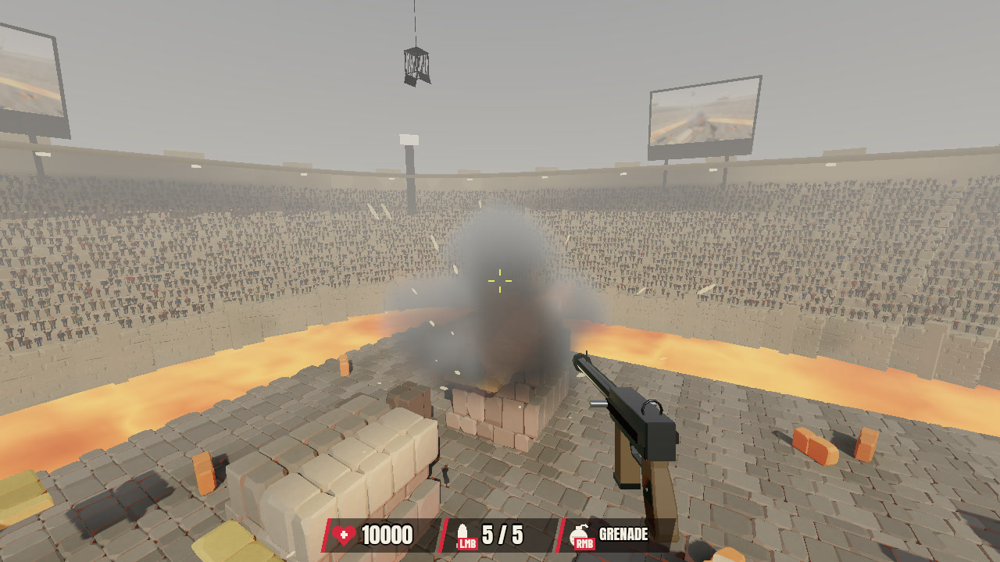
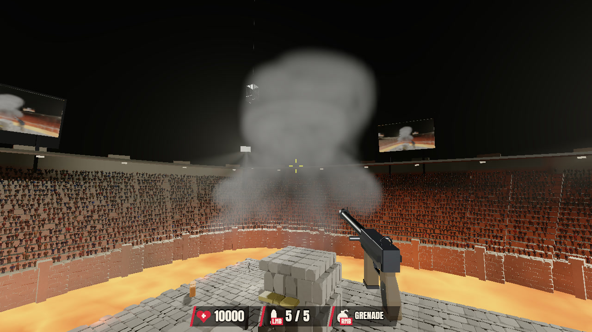

# Baked explosion smoke

Growing Guns' full desktop graphics profile replaces explosion smoke billows
with a compact, pre-baked 3D density animation. The fireball, flame tongues,
embers, heat distortion, flash and lights retain their existing recipe and
random sequence. Low/minimum profiles, including native Quest, retain billows.
`GG_BAKED_SMOKE=0` selects the earlier smoke for an identical-event comparison.
This is a visual trial; it does not change explosion damage or physics.

## Asset and rendering

The original [offline bake](../tools/bake-explosion-smoke.py) uses buoyancy,
velocity advection, pressure projection and vorticity to evolve a lobed blast.
It stores 32 frames of 48-cubed density plus baked directional transmittance,
covering 2.6 seconds of source motion with empty endpoints. See the [asset contract](../assets/fx/README.md)
and its checksum metadata. No Three.js runtime, VDB sample or external download
is needed by a game. The committed asset is 6.75 MiB and uploads once, lazily,
shared by all explosions and views.

`render::fx::Effects::set_baked_smoke(true)` opts subsequent explosions into
this path. The engine default remains off; blood/gib mist retain their own
recipe. Each blast has a seeded yaw and radius-scaled volume. At most 16 baked
volumes are retained; a new blast replaces the oldest at this limit.

Playback retains the first 1.2 seconds of the burst, then smoothly slows the
later frames into a 4.6-second lifetime. The low-density shape trim follows the
bake's fade envelope instead of cutting off sparse wisps at a fixed threshold.
The asset bytes and memory cost are unchanged; longer-lived smoke can increase
overlap between successive explosions.

The WGSL pass blends adjacent baked frames and raymarches density in the
volume's local coordinates. It samples each frame within its half-texel bounds,
so texture filtering cannot bleed into the next frame. Projected bounds limit
screen coverage; near-plane crossing expands coverage to support cameras
inside. Rays stop at the opaque scene depth. HDR uses at most 48 samples per
ray, with early termination; the optional LDR path uses 24. Growing Guns keeps
its low/minimum profile on the earlier smoke.

Smoke and fire share the per-view back-to-front translucent ordering. The pass
runs after temporal reconstruction and does not write TAA/DLSS history. The
normal interpolated effects clock drives every view; drawing another view does
not advance the animation.

## Review commands

```powershell
cargo test --locked -p render --lib fx::tests
cargo build --locked -p growing-guns-app
cargo run --locked -p render --example baked_smoke_gpu -- --out build/smoke-probe --size 1280x720 --samples 24
games/growing-guns/tools/capture-explosion-smoke.ps1 -Out build/smoke-baked
games/growing-guns/tools/capture-explosion-smoke.ps1 -Variant legacy -Out build/smoke-legacy
games/growing-guns/tools/capture-explosion-smoke.ps1 -Views 4 -Orbit -Out build/smoke-four
```

The game helper queues a real gameplay explosion, renders through the ordinary
game frame path and writes PNGs, the scenario and an MP4 when FFmpeg is present.
It opens no game window. `-Executable PATH` selects a separately built binary.
The GPU fixture isolates smoke for occlusion, camera-inside, animation,
lifetime, split-view and history checks, and times complete explosion effects
against the legacy recipe after warmup. These are development previews, not
store videos or target-frame-rate acceptance.

## Limits

- This is baked visual motion, not runtime fluid simulation. Geometry hides
  smoke but does not redirect it. The offline approximation is not combustion.
- The compact 48-cubed source is softer than a high-resolution VDB volume.
  Large close-ups and multiple overlapping explosions still need player review.
- Self-shadowing is baked from one local light direction and rotates with the
  plume. It does not follow world lights, cast shadows into the arena, or receive
  world shadow maps. It retains the existing effect exposure convention.
- Intersecting transparent volumes/fire use object sorting, not a joint medium
  integral. Transparent glass is not represented in the opaque depth clip.
- A 16-volume cap bounds lifetime/overdraw growth but does not guarantee a frame
  budget. Measure on the intended GPU and viewport; four-player 4K/120 FPS is
  not established by this feature's isolated fixture.

## Validation, 31 October 2026



The initial native MSVC dev build passed 11 focused renderer tests (including
WGSL validation) and 98 Growing Guns library tests; two optional game tests
are ignored. The committed bake's checksum, empty endpoints, temporal changes
and zero-density cube border were checked. Both game and GPU fixture build
with the committed Cargo lockfile.

The [native GPU report](data/baked-smoke-20261031.json) records 27,657 changed
pixels for exposed smoke and all 921,600 for the inside-volume view. Fully
occluded, pre-birth, expired and tail frames change zero pixels. All four
split-view tiles match their separately rendered views exactly. Removing the
smoke changes zero TAA-history pixels against an untouched renderer.

Measured on an NVIDIA GeForce RTX 5070 Ti, native 1280x720 output, no spatial
or temporal reconstruction, one radius-3.3m explosion at age 0.85 s. Four views
are 640x360 each. After 12 warmups, 24 samples per case give these median times
for the complete `fx` scope (copy, fire/smoke, sparks and heat):

| Recipe | One view | Four views, summed |
| --- | ---: | ---: |
| Legacy billows | 0.0154 ms | 0.0435 ms |
| Baked volume | 0.0586 ms | 0.2046 ms |

This bounded static scene excludes startup, compilation and image readback.
It is not a gameplay-FPS result or four-player 4K acceptance. It contains one
explosion; the 16-volume limit has not been established as a performance budget.

The initial game review ran a real queued radius-6.5m explosion with damage 0 in clear
air above the arena, retaining the normal game rendering path. 96 frames at
30 fps cover 3.2 seconds for both recipes and a four-view orbit. Early, middle
and fading frames were inspected. The result is visibly soft at close range;
it is an experimental compact bake, not parity with the high-resolution VDB
showcase. The generator and original asset use the repository MIT license.


## Slower tail revision

The original bake's final density fade covered only source time 1.7 to 2.6 s.
A fixed 0.025 density trim also discarded the penultimate frame's remaining
wisps. Playback now eases from normal speed at 1.2 s to a stop at 4.6 s, while
scaling the trim by the original density envelope. Early plume motion and the
6.75 MiB asset are unchanged. Fire and the other explosion effects keep their
own lifetimes.

The revised build passes all 11 focused renderer tests and the updated
[native GPU fixture](data/baked-smoke-tail-20261031.json). Rendered contrast
against an empty scene remains at 25.6% of the measured peak at the old 2.6 s
cutoff and 4.4% at 3.2 s. Sampling every 0.1 s from 1.7 to 4.6 s found no step
larger than 9.5% of peak contrast; the end frame is empty. Occlusion, inside
views, four-view equivalence and temporal-history isolation still pass. These
are image continuity checks, not a new performance measurement.

The capture helper now records 156 frames at 30 fps (5.2 s), including the
complete tail. The revised night review uses the normal stadium floodlights
plus a white 3000-lux directional key at elevation 25°, azimuth 60°. The fixed
camera aims slightly higher to keep the rising plume in frame. Later frames
were inspected as the smoke thins to nothing; world-light relighting remains
the separate limitation described above.


