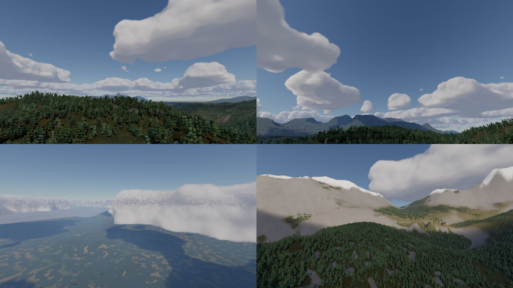
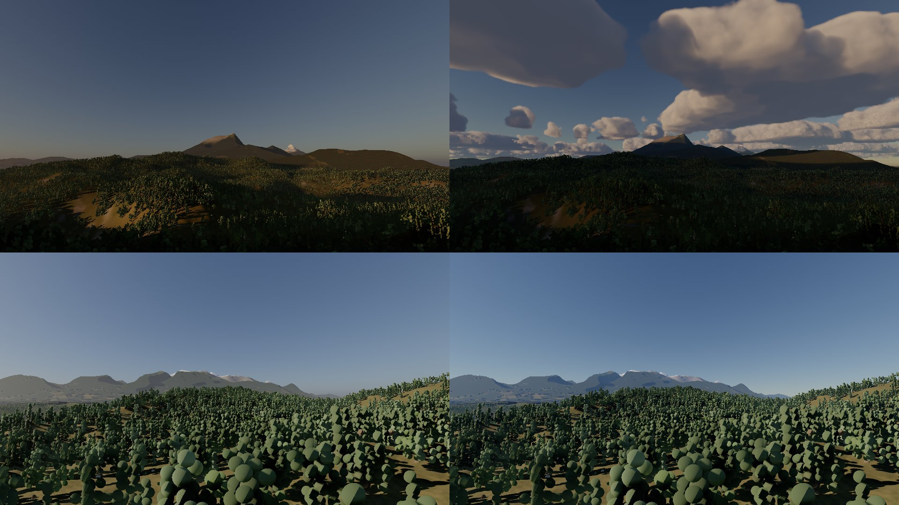

# Clouds, multiple scattering and aerial perspective, 8 November 2026

Gap 3 of the Unreal Engine comparison: volumetric clouds, a multiple
scattering sky and an aerial-perspective volume. How it works now is in
[atmosphere.md](../atmosphere.md); this note keeps the measurements and
what was tried.

Machine: the 2-CPU Linux cloud container, lavapipe (software Vulkan). No
real GPU numbers yet.

## Multiple scattering

`cargo test --release -p render --lib multiple_scattering -- --nocapture`,
default atmosphere, small test bake (64×32 sky), horizontal sky illuminance
RGB, single scattering then with multiple scattering:

| Sun | Single (lux) | Multiple (lux) | Ratio |
| --- | --- | --- | --- |
| 60° | 3074, 5658, 10451 | 4035, 8003, 17096 | 1.31, 1.41, 1.64 |
| 10° | 2464, 3717, 5456 | 2806, 4605, 8167 | 1.14, 1.24, 1.50 |
| 2° | 1612, 1595, 1779 | 1782, 1935, 2686 | 1.11, 1.21, 1.51 |
| -3° | 190, 105, 149 | 223, 145, 266 | 1.17, 1.38, 1.78 |

The direct sun is unchanged. Exposure presets in `render::sky` were not
retuned; a daylight scene under the procedural sky gets somewhat brighter
shadows.

## Cloud look, five rounds

terrain_fly default biome, seed 1, 960×540, 10 frames (`--shot`), views
`--at 0,0,60,0.6,0.25`, `0,0,30,2.2,0.5`, `0,0,2600,0.6,-0.12` and alpine
`0,0,200,0.6,0.08`.

1. Weather cells of 9 km and Perlin-Worley without contrast: smooth
   lenticular slabs, the 3D noise never showed.
2. Weather cells of 4 km, a sharper coverage edge, shape tile 3.5 km,
   detail 0.9 km: cumulus outlines, but extruded weather blobs with
   rounded tops, and ribs at the horizon from interleaved gradient noise
   beating against the march steps.
3. The weather lowers the threshold the 3D shape must clear (instead of
   multiplying it in), stronger erosion, white-noise jitter: lumpy
   cumulus, no ribs; still grey.
4. Multiple-scattering octaves with contribution falling slower (0.7) than
   extinction (0.4): white tops, grey bases. Below the horizon the bake's
   ground (seen past the end of the terrain from 2.6 km up) is faded by
   the aerial perspective instead of showing as a tan band.
5. Sunset (`--hour 19.3`) and aerial perspective without clouds compared
   with the old distance fog.

Aerial perspective at the default atmosphere is clearer and bluer than the
old summer haze (0.05/km fog): far mountains stay blue instead of fading to
grey-white.

## Cost

`terrain_fly --bench 20 --size 1280x720` on lavapipe: `sky volume` 102 ms,
`shade` 128 ms, `shade terrain` 134 ms (whole frame about 5 s). Software
rendering only says the pass costs a little less than one shade pass.

## Follow-up: clouds moving while standing still

Joep (Mancave, terrain_fly) saw the clouds move with the camera still.
`--dump 24` at 640×360 looking up, wind off: frames 12 to 23 change by 0.13
of 255 on average in the sky, so the march and its history are stable; the
motion was the wind drift (8 m/s) plus the detail noise drifting 1.5 times
faster, which made the edges boil. Now the detail moves with the cloud, the
default wind is 4 m/s along x and 1.5 m/s along z, the per-pixel jitter
advances by the golden ratio each frame instead of being new white noise,
and the march towards the sun is jittered too (fixed sample points can band
the self-shadow under a large cloud into steps).

Joep then reported that the clouds jumped up and down (Mancave, DLSS,
about 26 fps). The pass traced its rays with the jittered projection the
depth buffer was drawn with, but it runs after TAA/DLSS have removed that
jitter, so the clouds hopped by the sub-pixel jitter every frame (by
several output pixels under DLSS). Rays and the cloud history now use the
unjittered view-projection; only depth reconstruction uses the jittered
one. Same dump with still clouds (native TAA, lavapipe): mean change per
frame in the sky 0.153 → 0.054 of 255.

Joep still saw motion, mostly when flying up. The march worked in planet
coordinates (camera at 6360 km from the centre, f32), so the altitude of
every sample was a difference of two large numbers and rounded differently
each frame as the camera rose. The shell intersection and the density now
use the altitude along the ray directly (h0 + t·(mu + t·(1-mu²)/2R)), and
the cloud history blends 0.06 instead of 0.12 of the new frame.
`terrain_fly --dump 24 --climb` (new: holds climb), 640×360, wind off,
mean change / mean frame-to-frame jerk in the sky, of 255:

| Case | Before | After |
| --- | --- | --- |
| Standing | 0.055 / 0.111 | 0.029 / 0.058 |
| Climbing from 30 m | 0.061 / 0.117 | 0.037 / 0.068 |
| Climbing from 1200 m | 0.083 / 0.130 | 0.071 / 0.111 |
