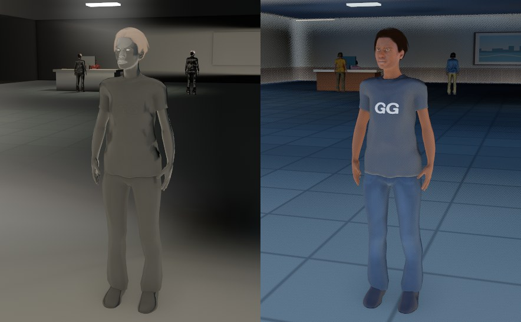
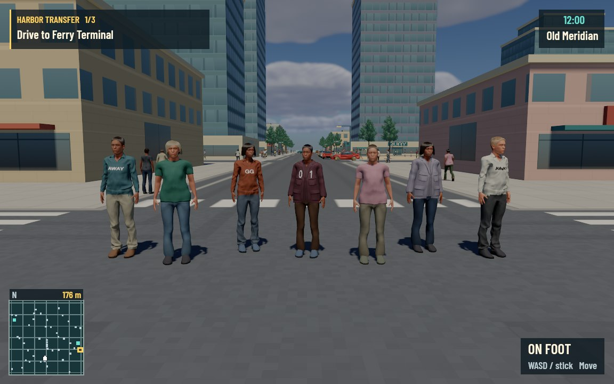

# Port Meridian crowds, daylight and Luau stories

On 22 November 2026, the city playtest added an in-session Luau story editor, three missions, distant pedestrians, vehicle impacts and a continuous sun clock. The native measurements below used the same street cameras, seed 1948 and an NVIDIA GeForce RTX 5070 Ti on Windows. Each row measures 100 frames after a 40-frame warmup. The render benchmark holds the camera and simulation state fixed.

| Native street scene | Resolution | Previous median / p95 | Updated median / p95 |
| --- | --- | --- | --- |
| One walker | 1440 × 900 | 12.12 / 17.97 ms | 7.95 / 13.05 ms |
| Four separate streets | 3840 × 2160 | 23.92 / 28.13 ms | 24.14 / 27.73 ms |

Four native 4K views exceed the 8.33 ms target for 120 Hz. Separate CPU tests advance traffic, character physics and daylight so that fixed-camera timings cannot hide a stalled simulation.

## The doorway

These WebGPU screenshots use the same city seed, avatar, camera and noon lighting, 2.4 m inside the same office entrance. The first release supplied zero room irradiance to the full shader. A traced preview now supplies immediate light and refines it across frames as the player enters. The compact shader also reads room transport and fixture light. Both paths recover the shirt color and skin tone. Browser scenes were staged through a private test harness using the released engine and game assets.

## People and vehicles

Each of the 696 outdoor residents can retain their identity as a distant, animated instance or a fitted Warp Human. Forty residents can use fitted actors at once, shared across the views. Their 72 seeded appearances use 12 shared atlas layers. The crossing below stages seven selected city residents together to compare their outfits and builds. Day and night departures are staggered and close observers keep the people they can see.

Twelve traffic sedans each drove 266–349 m in a simulated minute. The four-room test fits 1,140 entities within the city's 1,280 budget. A separate recorded drive used normal throttle and actual chassis contact to knock a resident down. The driver, a second player and an AI traffic car are covered by the impact regressions.

## Changing the game during play

The city exports `apply_story` and offers the same passenger, race and contract templates in the controller mission picker and the browser editor. A browser worker evaluates the author program with the compiled Warp WebAssembly module and its own Luau VM. The live game checks the resulting data and installs the new cast. A script can compute routes with loops, choose outfits and cars, sequence actions and give the player objectives. The author can save the source as a local file.

The shared daylight API interpolates the atmospheric radiance, light on clouds and diffuse skylight. Direct shadows follow the moving sun. Indoor transport starts with a traced preview and the browser refines at most four probes across all occupied rooms per frame, checking a 0.75 ms budget after each probe.

## Browser release checks

The public v1.1 build from `8d8308f7` loaded the city on both the full and minimum-limit WebGPU paths. In the two-seat test, player one drove at 31 km/h while player two stayed on foot in a separate view. The editor ran a computed route, rejected malformed Luau and an unknown mission action, downloaded and reopened identical author source, and kept the draft across a return to the Game Room. The native integration run passed 88 tests. The remote party service returned HTTP 429 during repeated lobby registrations from the test machine. Local split-screen and the story editor continued working.

[Play Warp Theft Auto](https://splitscreen.club/playtests/warp-theft-auto/v1.1/?game=warp-theft-auto&players=1) · [Game and authoring guide](../../../games/warp-theft-auto/README.md)
