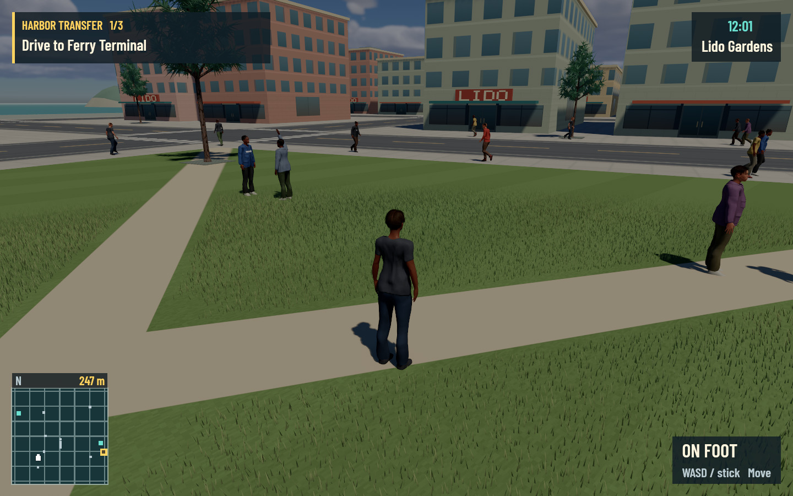
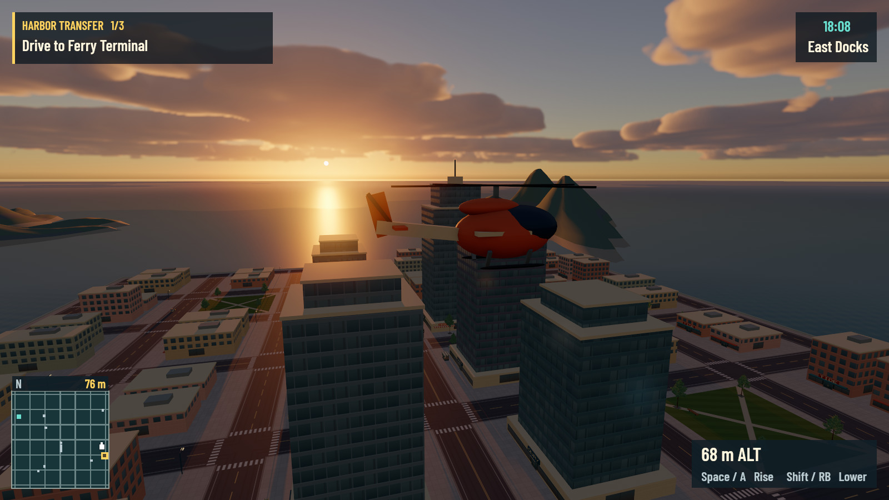
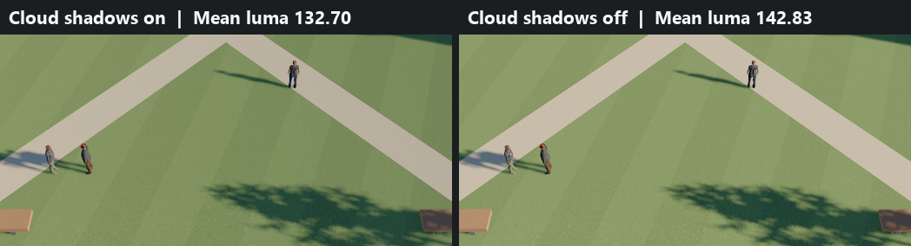

# Port Meridian lawns and cloud shadows

On 22 November 2026, the native Windows build of Warp Theft Auto at `5b73b537` rendered both parks with mown grass and the harbor with volumetric clouds on an NVIDIA GeForce RTX 5070 Ti. The solo walk at Lido Gardens took 5.96 ms per frame at the median. Four views at native 4K took 18.65 ms, 10.32 ms over the engine’s 8.33 ms target for 120 Hz.

| Native headless scene | Output | Frames | Wall median | Wall p95 |
| --- | --- | ---: | ---: | ---: |
| Solo walk, previous park surface and sky | 1440 × 900 | 90 | 4.29 ms | 5.56 ms |
| Solo walk, mown grass and clouds | 1440 × 900 | 90 | 5.96 ms | 6.88 ms |
| Four players, previous park surface and sky | 3840 × 2160 | 100 | 16.06 ms | 17.81 ms |
| Four players, mown grass, clouds disabled | 3840 × 2160 | 100 | 18.54 ms | 21.10 ms |
| Four players, mown grass and clouds | 3840 × 2160 | 100 | 18.65 ms | 20.71 ms |

The solo run warmed for 32 frames at tick 70. The four-player run warmed for 40 frames at tick 77 with three cameras near a park. Each timed frame rendered the same simulation tick and waited for GPU completion. In the earlier 24 m configuration, grass alone took 20.38 ms at 4K. The final 16 m range reduced candidate clumps from 13,225 to 6,241 per nearby view. It keeps 60 blades per clump at full opacity to 11.52 m and then fades into the mown surface. Short-range lawns use ordinary depth testing and skip the per-view depth pyramid. [Four-player scenario](../../../games/warp-theft-auto/scripts/park-grass.json)

The installed flight tour boarded the helicopter and captured East Docks at sunset. This 1600 × 900 view took 3.88 ms at the median and 4.48 ms at p95 over 60 frames.

At Lido Gardens, launch seed 24 placed a cloud shadow over the lawn at 09:00. The two images hold the camera, simulation tick 180 and exposure 13 fixed. Changing only cloud shadow strength from 0.5 to 0 raised mean display luma from 132.70 to 142.83 on the 0–255 scale. The measurement uses the original 1280 × 800 PNGs, cropped from (380, 430) up to (900, 675), and the standard 8-bit grayscale conversion. The shadow lowered mean luma by 7.1%. The noon check with launch seed 1948 showed a clear patch at the sampled location.

