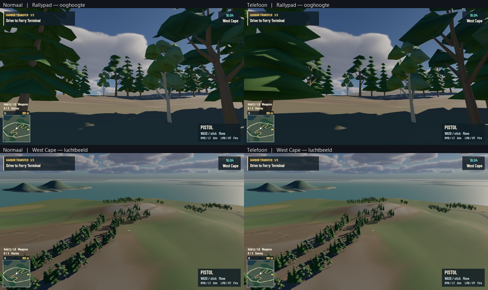

# Mariner Wood on phones

Warp Theft Auto commit `f892a516`. Headless Windows tests on Mancave with an RTX 5070 Ti used one 960×540 view and city seed 1948. The game planted 530 trees on both tiers. The ground camera stood at (−827, −33) in X/Z, 2.1 m above the trail. The aerial camera stood at (−780, 73, −166) in X/Y/Z. Both profiles used the same low surface detail.

| Placed model | Instances | Trees per instance | Regular triangles per instance | Phone triangles per instance |
| --- | ---: | ---: | ---: | ---: |
| Mixed woodland stand | 26 | 15 | 14,270 | 1,810 |
| Rally roadside group | 31 | 4 | 3,048 | 468 |
| Hillside broadleaf | 16 | 1 | 7,294 | 256 |
| Total across placements | 73 | | 582,212 | 65,664 |

The totals count source triangles across placements before view culling. The reduced models use 88.7% fewer triangles. Their three additional game files total 32,017 uncompressed bytes. This version of the browser launcher downloads both asset sets on startup.

The rear crowns and the gaps along the trail remain legible in both aerial views. At ground level the phone crowns have visibly angular edges. The trunk streaming regression passed with two seats in both profiles. All 15 tests in the Warp Theft Auto integration target passed with the phone profile.

With 40 warmup frames followed by 120 GPU timestamps per fixed view, frame costs in milliseconds were:

| Scene | Regular median | Phone median | Regular p95 | Phone p95 |
| --- | ---: | ---: | ---: | ---: |
| Rally trail | 1.537 | 1.335 | 3.963 | 3.053 |
| Aerial | 1.346 | 1.175 | 2.387 | 2.724 |

The GPU median fell in both views. The aerial p95 rose in this run. All four captures returned 120 valid samples. Wall-clock timings varied between repeats. A physical handset frame time is still open.

