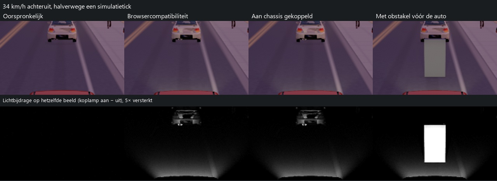

# Sedan headlight cutoff while reversing

Warp Theft Auto, fix `9af35468`. The Toyama's grille could block its own headlight while reversing. The old mount sat inside the front of the car and took the latest seat position. At 34.23 km/h the car travels 15.85 cm per 60 Hz tick. The grille is drawn between ticks, so it could pass in front of the lamp even with a steady speed and steering angle.

The current runtime draws the light from the same interpolated chassis transform as the mesh. The mount is 6.95 cm ahead of the foremost bumper vertex. Hosts with the world-space spotlight API place the light far enough forward to clear the previous and current bumper positions during reverse travel.

## Driver-camera replay

Mancave, GeForce RTX 5070 Ti, one headless 960 x 540 view. With city seed 1948 and dawn held at 05:45, the driver entered sedan 4 and held reverse until it reached 34.23 km/h. Each of the five captures sampled the same simulation tick at a different interpolation fraction, after ten settling frames. Each count is the number of pixels in the same 310 x 156 road region that gained more than ten luminance codes compared with headlights off at the same fraction.

| Headlight placement | 0 | 0.25 | 0.5 | 0.75 | 1 |
| --- | ---: | ---: | ---: | ---: | ---: |
| Original | 0 | 0 | 0 | 0 | 1,158 |
| Fix on the existing browser host | 1,311 | 1,333 | 1,370 | 1,394 | 1,420 |
| Fix on the runtime with chassis-mounted lights | 1,306 | 1,291 | 1,301 | 1,316 | 1,293 |

An independent blocker seven metres ahead still cast a shadow. With the chassis-mounted light at the halfway frame, adding the blocker reduced the mean headlight contribution on the parked car behind it from 8.82 luminance codes to within one code of zero. The road in front of the blocker retained 11.46 of its original 11.85 codes.

The game regression `reversing_sedan_headlight_stays_ahead_of_its_interpolated_bumper` covers turning in reverse with two seats and checks five draw fractions per tick. A separate replay of the world-space fallback also checked turning, switching the lamps on mid-reverse and teleporting.

