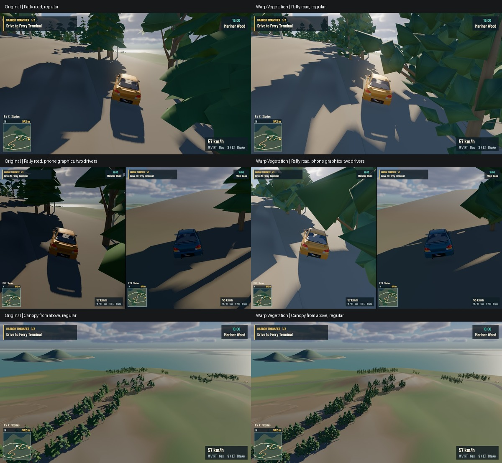

# Grown tree species on the Mariner Wood rally route

Game and cooker commit `c16ddace`. The baseline used the game tree at `5537fb28`. Both games ran on the same Warp executable. The cook used the engine's Jeffrey pine and Norway spruce growth models and its birch and broadleaf recipes. Each tree had a fixed growth seed and age. We measured the checked-in game meshes, including the fern understory and street planters.

## Trees in the scene

With city seed 1948, West Cape contained 26 stands of 15, 31 roadside groups of four, and 16 single hillside trees. The city contained 52 additional street and park trees. Both tiers retained the original positions and trunk collisions. The two tiers select separate static assets at game startup. The regular cook follows the limbs with tapered groups of shoots. The phone cook encloses clusters of the same foliage samples. Neither requires the game to grow, skin or allocate one entity per branch.

| Across the 530 West Cape trees | Old | Grown |
| --- | ---: | ---: |
| Regular source triangles | 582,212 | 479,778 |
| Phone source triangles | 65,664 | 60,650 |

Counts include every placement before view culling. Including the city trees gives 559,754 triangles on regular and 72,506 on phone. The three regular assets total 132,399 bytes (49,951 bytes gzip). The three phone assets total 37,900 bytes (11,638 bytes gzip). The browser fetches both sets and draws the selected tier. Running the bake a second time produced all six files byte for byte.

## Driving benchmark

The native headless release build ran on Mancave, Windows, GeForce RTX 5070 Ti, driver 621.24. Both profiles used low surface material detail and one native 960 × 540 output with reconstruction disabled. Two players split that output left/right. Each driver took the wheel of a separate sedan at a fixed position on the trail and held the same throttle. The first car reached 57 km/h. Camera and vehicle state matched exactly between before and after, including for the second driver. Each run had 40 warmup frames followed by 120 valid GPU samples.

| Tree profile | Players | Old GPU median | Grown GPU median | Old GPU p95 | Grown GPU p95 |
| --- | ---: | ---: | ---: | ---: | ---: |
| Regular | 1 | 1.669 ms | 1.648 ms | 4.031 ms | 3.523 ms |
| Regular | 2 | 3.255 ms | 3.241 ms | 5.574 ms | 5.647 ms |
| Phone | 1 | 1.496 ms | 1.420 ms | 2.928 ms | 3.156 ms |
| Phone | 2 | 3.152 ms | 3.047 ms | 5.039 ms | 5.287 ms |

The median GPU cost stayed close to baseline in all four cases. The p95 rose by up to 0.25 ms in three of them. CPU submission medians for the new trees ranged from 9.5 to 16.0 ms on the shared machine. These figures cover steady driving. Hardware phone performance and sustained performance at higher resolutions remain unmeasured.

The regular roadside crowns break into separate branches. Close to the chase camera their edges and shadows still show the polygon budget. Crown shapes on the phone tier are visibly coarser.

## Browser playtest and cold start

Headless Microsoft Edge on the same desktop GPU successfully loaded the public baseline and the isolated preview. A test-only script moved player one to a fixed ground camera in Mariner Wood. We observed the three expected assets in calls to spawn on both tiers, all HTTP requests for game files succeeded, and the tree geometry appeared in the game canvas. The browser picks a fresh city seed, so its stand counts can vary from the fixed native benchmark.

On a fresh browser launch, Edge reported the first *completed* frame at 93.0 seconds for the public phone preset and 111.7 seconds for the preview phone preset. Regular preview took 106.4 seconds. The preview phone run logged 1.2 seconds for game-script initialization, 1.9 seconds to prepare people, 0.32 seconds to set up the scene and 0.007 seconds for explosion setup. Its first frame submission was reported at 7.4 seconds. The completion notification also waits for the GPU queue. These single desktop runs leave the source of the long first presentation unresolved. A physical handset cold launch and drive remain open.
