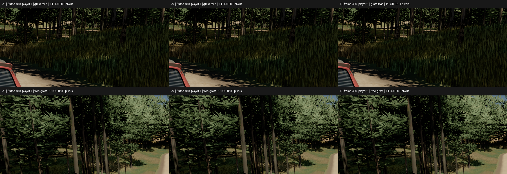

# Distant grass sampling cost — r58

The current production aggregate is one source-derived directional surface
billboard per retained grass root. It is not a multi-root voxel volume. World
placement, source recipes and atlas payloads are shared, but each player view
still rasterizes overlapping root billboards and reconstructs their coverage.

In the previous r57 full-resolution 25–35 m experiment, four views submit
220,508 surviving aggregate roots at frame 480: 441,016 triangles in each of
two passes. Depth and material together cost 3.160/5.616 ms in the two route
sections; aggregate illumination costs 0.677/0.806 ms. Placement of source and
aggregate together costs only 0.451/0.540 ms. These are measured frame-summed
groups, not an assumption that one camera represents all four.

The depth/motion and material passes both reconstruct an aggregate surface.
Up to four directions and two mip levels contribute filtered material/normal
samples, followed by a discrete representative surface/anchor search. The
material pass accumulates fractional coverage from overlapping roots against
opaque scene depth. Full grass lighting already runs once per resolved pixel;
it does **not** run for every overlapping root. Shader source sample counts
are upper bounds, not hardware invocation counters or compiler-disassembly
evidence.

Moving this representation closer exchanges source geometry for more aggregate
pixel work. That explains why r57's earlier-only setting did not save time.
Half-resolution aggregates saved time but visibly blurred detail; they remain
an opt-in quality tradeoff, not the accepted default.

## Full-resolution experiment

`KERN_MEADOW_AGGREGATE_SAMPLE_PRUNE=1` is default off. It skips precisely zero
angular weights before atlas sampling, and delays point/anchor fetches until
the strongest representative tap is known. All nonzero weights, accumulation
order, strict-tie selection, coverage thresholds, filtering, geometry, wind,
source range and output resolution are retained. The current group-cache path
does not carry this specialization; combining both options returns an error.

Constructed state is stored on the renderer and included in capture metadata;
it is not inferred by rereading the environment after pipeline construction.
Four selection/shader tests cover borders, mip endpoints, zero coverage, ties
and actual specialized shader entry points. They establish intended selection
semantics, not GPU bit parity.

`KERN_MEADOW_CAPTURE_RAW=1` adds scenario-capture-only export of aggregate HDR
color, material/normal moments, revealage, reversed depth and current motion.
The files preserve packed GPU float/half-float bits before composition and
DLSS. Texture handles retain existing allocations; staging buffers, GPU copies
and the synchronous wait occur only on an explicitly requested capture.
Per-frame readiness prevents stale views/motion from being exported. Two CPU
tests cover row alignment, odd dimensions and preservation of raw bits.

Runtime source is `d5fea46b4d483376033d7a08d16f1b918527b3af`. Frozen executable:
`C:/dev/perf/warp-sideways-20261027/r58-meadow-sampling/sideways-r58.exe`, SHA256
`ac95dfa6632f4236583989aa2ab4db1d53ec88ad8795ce7770d7a5a74389c203`.
524 renderer and 185 CLI tests passed, one ignored in each suite. Developer
launcher contract checks passed; the DLSS release build took 83 seconds.

## Measurement and image checks

Six alternating OFF/ON runs completed with this single binary,
one 3840×2160 output, four 1916×1076 panels and actual DLSS Performance input
of 958×538 per panel. Both variants retain full-resolution aggregate targets,
the 25–35 m source band and 160–180 m outer fade. Each section provides 179
clean synchronized GPU frames per run after warmup/captures; values are medians
of three run medians. These intervals are not interactive gameplay FPS.

Separate A/A/B raw QA captures all four views at frames 60/240/480 of the same
480-frame route. Same-mode variation must be measured before attributing a
difference to pruning: GPU-compacted draw order can change floating-point OIT
accumulation. Full-output PNGs are supplemental; they cannot establish raw
depth, coverage or motion equivalence through DLSS.

The first timing run completed, but the harness confused full geometry target
size with per-player viewport size. Its failure and original inputs remain
intact. The corrected `timing-v2` harness checks full output, all viewport
origins/dimensions, internal input and frame identity separately. Nine harness
tests pass; CPU revalidation accepts the original GPU run, which is retained
as smoke evidence rather than mixed into the new six-run comparison.

| Four-view measurement | First OFF / ON ms | Continued OFF / ON ms |
| --- | ---: | ---: |
| Total GPU interval | 27.645 / 27.005 | 33.734 / 32.976 |
| All meadow root scopes | 7.284 / 6.502 | 9.398 / 8.452 |
| Aggregate envelope | 4.169 / 3.307 | 6.729 / 5.694 |
| Aggregate depth child | 1.289 / 1.010 | 2.283 / 1.961 |
| Aggregate material child | 1.859 / 1.391 | 3.354 / 2.707 |
| Aggregate illumination child | 0.675 / 0.675 | 0.805 / 0.806 |

The aggregate envelope falls **20.7% / 15.4%**; total meadow falls
**10.7% / 10.1%**. Whole GPU interval falls **0.640 / 0.758 ms**. These are
same-executable measured deltas, not estimated fetch counts. Children are
attribution inside the parent; independently computed medians are not
additive. All 2,880 GPU frame records validated, with 537 clean frames per
variant/section and matching state, source/aggregate geometry and opaque
selection fingerprints. Complete per-pass/per-view repeat ranges are in
[the CSV](../data/meadow-sampling-r58-passes.csv); frame-summed root groups are in
[group costs](../data/meadow-sampling-r58-group-costs.csv).

Raw A/A/B QA covers 6,184,848 input pixels across 12 view/frame cases, including
292,726 covered pixels. All values are finite. **Every depth and motion byte
matches** for all three pairs; positive coverage/material/motion masks have
zero differing pixels. OIT moments and illuminated color are not bit-identical,
including A/A. Covered alpha MAE is 2.263e-5 for A/A, 2.401e-5 for A1/B and
2.335e-5 for A2/B. Maximum differences are 0.002441, 0.002441 and 0.002930.
Conditional pigment MAE is 5.16e-5 / 5.38e-5 / 5.22e-5. This is consistent
with existing floating-point accumulation-order variation; a same-mode control
is not a formal acceptance tolerance or proof of its exact cause. Unexposed
HDR errors must not be interpreted as display RGB errors. See the
[compact raw results](../data/meadow-sampling-r58-raw.json).

A reviewer inspected lossless pixel-crop boards for every view at all three
frames; the primary reviewer also inspected player 1 at 480 and player 2 at
240. No new blur, holes, halos or shifted silhouettes were visible. Existing
wall-like grass edges and distant patchiness remain. This is a sparse still
check, not a moving-transition or all-weather certification. The pruning switch
remains opt-in, with no default promotion. Total grass remains above 4 ms and
the frame remains well above the 8.33 ms goal.

Evidence root: `C:/dev/perf/warp-sideways-20261027/r58-meadow-sampling/`.
`timing-v2/trial-a/report.json` contains the six runs;
`timing-v2/analysis-a/` contains medians and source hashes;
`raw-qa/qa-a/` contains original layers and images;
`raw-analysis-a/` contains all comparisons; `raw-contacts-a/` contains review
boards. Original failed-harness evidence is retained separately in `trial-a/`.

## Larger remaining opportunity

Opaque Hi-Z rejection is already implemented. Fractional grass coverage cannot
simply become a solid occluder without hiding visible terrain or other grass.
Sharing more placement work does not remove the dominant per-view fragment
cost. A bounded tile gather could evaluate a root/pixel surface once and
produce both OIT material moments and nearest depth/motion, with an explicit
overflow fallback. Its binning, bandwidth and gather costs need measurement.
Spatially grouping many roots is another structural option; optical coverage,
wind and gaps must survive that reduction. Neither is implemented or promised
as a measured speedup by this experiment.
