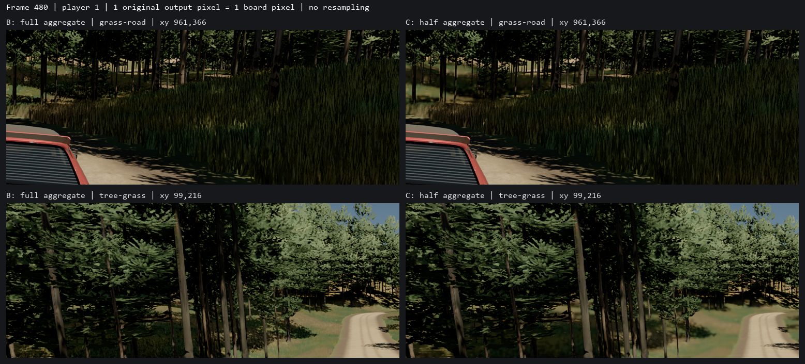

# Earlier, reduced-resolution aggregate grass — r57

This experiment tests the user's request to hand detailed grass over earlier.
It adds an opt-in reduced-resolution aggregate path rather than assuming that
the existing distant representation becomes cheaper when moved closer.
No graphics default is promoted. The 8.33 ms four-player target is unchanged.

## Implementation

`KERN_MEADOW_AGGREGATE_HALF_RES=1` requires the existing aggregate path to be
enabled. It renders the aggregate's depth, material moments and illumination
at half the linear internal-view dimensions, rounded up. Detailed source
grass and the final merge remain at full internal resolution. It is currently
incompatible with `KERN_MEADOW_GROUP_CACHE`; that combination returns an error.

The half path conservatively reduces opaque reversed depth using the minimum
over every overlapping input pixel, including odd-sized viewport footprints.
The merge gathers four low-resolution taps, reconstructs their representative
points on the current full-resolution pixel ray and rejects samples behind
the untouched opaque depth. Rejected weights stay zero rather than being
renormalized into foreground coverage. Dominant coverage supplies the motion
representative; its distance is recomputed on the full pixel ray. The ray uses
the same homogeneous construction as the motion consumer, avoiding near-plane
subtraction precision loss.

World-cell roots, density, palette, source recipes, wind and outer coverage
remain unchanged. This is a spatial approximation of the existing directional
surface aggregate, **not voxel transport**. Filtered material moments and a
single depth representative cannot separate every overlapping grass layer.
Fine silhouettes and moving foreground boundaries therefore require review.

The existing aggregate-depth timing scope includes the conservative reduction
and seed copy. Aggregate depth/material/illumination scopes are children of
the aggregate envelope; totals count root scopes only. Captures expose actual
target dimensions, resolution ratios and mode for each view. No target is
inferred from a requested setting alone.

## Controlled experiment

One immutable executable built from `72db92f4331aed63f35c58162f09ce82323391ca`:
`C:/dev/perf/warp-sideways-20261027/r57-cheaper-grass/sideways-r57.exe`.
SHA-256: `faac17848bf3fec16707b50c0a1808dcb3f91cfbd640be0900cd6afa43af1a83`.
518 renderer tests and 185 CLI tests passed, one ignored in each suite. The
release build with `render/dlss` completed in 94 seconds. GPU smoke confirmed
the half path and zero invalid source visibility IDs in all four views.

| Variant | Detailed-to-aggregate band | Aggregate target per view |
|---|---:|---:|
| A | 60–80 m | 958×538 |
| B | 25–35 m | 958×538 |
| C | 25–35 m | 479×269 |

All three use 3840×2160 output, four 1916×1076 panels, and actual DLSS
Performance input of 958×538 per panel. Outer grass fade stays 160–180 m.
The original 480-frame route, clear/noon lighting, seed, assets, saved baseline
and 120 Hz/four-substep physics are fixed. The order is A/B/C/B/C/A/C/A/B,
three runs each, with 179 clean frames per section/run after warmup and
captures. Timings are hidden synchronized GPU intervals, not gameplay FPS or
CPU execution time. Host/CI load is not controlled.

Full-output PNG QA is separate from timing. It compares B/C at frames
60/240/480 plus 24 consecutive frames 228–251. This is only 0.2 seconds of
simulation at 120 Hz; it cannot certify every route, weather or wind state.

## Repeated GPU results

All nine runs completed with zero profile drops/errors and zero invalid meadow
visibility IDs. The 480 car/camera/light state hashes match across modes.
There are 537 clean frames per variant per section. Values below are the
median of three per-run medians; brackets show the minimum and maximum run
median. Group costs are summed within each frame before taking a median.

| Section | Measurement | A ms | B ms | C ms |
|---|---|---:|---:|---:|
| First | GPU interval | 27.828 [27.356–27.829] | 27.914 [27.734–27.956] | 25.938 [25.386–25.984] |
| Continued | GPU interval | 34.098 [34.021–34.177] | 34.181 [33.953–34.382] | 30.229 [30.204–30.364] |
| First | Total meadow, root only | 6.895 [6.850–7.003] | 7.375 [7.340–7.406] | 5.001 [4.969–5.040] |
| Continued | Total meadow, root only | 9.545 [9.314–9.617] | 9.626 [9.423–9.754] | 5.782 [5.777–5.860] |
| First | Aggregate parent envelope | 1.532 [1.498–1.539] | 4.215 [4.206–4.221] | 1.810 [1.748–1.921] |
| Continued | Aggregate parent envelope | 4.273 [4.127–4.413] | 6.934 [6.662–7.106] | 3.100 [3.073–3.163] |

Moving the existing aggregate closer alone (B) does not improve this route:
lower source-geometry cost becomes more aggregate pixel work. Reducing that
work (C) lowers total interval by **1.890/3.869 ms** relative to A, about
**6.8%/11.3%**. Meadow falls **27.5%/39.4%**. These are measured package deltas
within the same executable, not savings extrapolated from triangle counts.

| Aggregate child, summed across four views | First A / B / C ms | Continued A / B / C ms |
|---|---:|---:|
| Depth, including C's reduction/copy | 0.467 / 1.288 / 0.599 | 1.399 / 2.280 / 1.053 |
| Material | 0.668 / 1.868 / 0.727 | 2.150 / 3.336 / 1.372 |
| Illumination | 0.305 / 0.677 / 0.339 | 0.520 / 0.806 / 0.407 |

These child medians are attribution, not additive estimates of the parent or
total. The complete per-pass/per-view medians and repeat ranges are in
[the checked-in CSV](data/meadow-half-r57-passes.csv). Actual meadow per view is:

| View | First A / B / C ms | Continued A / B / C ms |
|---|---:|---:|
| 0 | 1.749 / 1.781 / 1.198 | 2.537 / 2.607 / 1.455 |
| 1 | 1.681 / 1.783 / 1.219 | 2.342 / 2.344 / 1.355 |
| 2 | 1.751 / 1.869 / 1.286 | 2.399 / 2.397 / 1.436 |
| 3 | 1.654 / 1.789 / 1.214 | 2.270 / 2.254 / 1.344 |

The measured grass targets remain above 4 ms, and both total sections remain
above the approximately 25 ms decision gate. 8.33 ms is still far away. The
user authorized this bounded earlier/cheaper-grass follow-up after the r56
gate; it does not authorize silently lowering the target or treating further
renderer rewrites as already accepted.

The remaining C costs include source resolve **1.863/1.284 ms**, source/far
placement **0.455/0.538 ms**, hardware scene raster **7.797/10.239 ms**, camera
cull plus Hi-Z **2.811/3.553 ms**, shade **4.077/4.002 ms**, and DLSS
**2.362/2.602 ms**. These are independently frame-summed group medians, not
four times a representative camera or an additive frame estimate. Exact scope
definitions/ranges and A/B/C comparisons are retained in
[group costs](data/meadow-half-r57-group-costs.csv). The unchanged scene raster
is the largest remaining group; this experiment did not optimize it.

In the first matched A/B/C captures, source and aggregate root/triangle counts
are exactly equal between B and C. Reported aggregate target allocation drops
from 41,232,320 to 21,646,968 bytes per view (includes full-resolution merge and
motion resources; excludes other scene resources and allocator overhead).

The runner's canned budget report again selects zero samples because it
excludes diagnostics while hidden rendering marks `diagnostic_sync=true`.
The strict analyzer explicitly accepts synchronized GPU samples and excludes
warmup/captures. The timings above come from all valid raw timestamp records,
not that empty canned report. An inherited `geometry_scope` prose field also
incorrectly says two source submissions; authoritative `source_geometry_passes`
and submitted-count fields correctly report one visibility submission.

## Image review: not accepted as the default

Both separate PNG runs passed matching checks for all 480 simulation/render
state hashes, actual output/input dimensions, all four camera/light traces,
and source/aggregate geometry counts. Each produced 26 untouched 3840×2160
PNGs. DLSS Performance is still active; these are full-output captures, not
native-resolution rendering.

Two reviewers inspected 28 unresampled B/C crop boards: all four players at
frames 60/240/480 and 228/236/244/251. The primary reviewer also inspected the
A/B/C/A-repeat timing previews for player 1 at 60/240/480 and the full C PNG
at 60. The main result is a visible regression: at frame 480, C smooths
distant grass/ground patch and shadow detail into broad bands, including near
lower background trunks. The nearer grass silhouettes and car/road edges
remain broadly similar; no clearly new large holes or bright halos were seen
in the reviewed crops. Thick wall-like blades, abrupt verges and existing
bare patches remain in both modes.

This fails visual-equivalence/default acceptance. Retain C only as an opt-in
measured tradeoff; B alone has no measured performance advantage here. Do not
promote either setting automatically. The recorded short motion sequence is
available in the local viewer, but review used sparse stills: temporal
shimmer/ghosting and a complete moving band crossing remain **unaccepted**.
The exact contribution of low-resolution filtering versus DLSS history to
the smearing was not isolated by raw-buffer captures.

The next quality investigation should isolate aggregate coverage/material and
depth/motion before DLSS, or reduce redundant full-resolution aggregate shader
work. Another distance/quality change without that check would not establish
that this visible failure is repaired. Neither investigation is claimed done.

## Evidence

Evidence root: `C:/dev/perf/warp-sideways-20261027/r57-cheaper-grass/`.
The build manifest, prepared input pins, serial-run records and visual QA are
retained there. `trial-a/report.json` contains the validated nine runs;
`analysis-a/summary.json`, `summary.md` and `passes.csv` contain repeated medians.
`audit.json` and `group-costs.json/.csv` contain the independent all-nine-run
accounting audit. `visual-qa-prep/qa-a/report.json` contains mechanical PNG
validation; `visual-qa-prep/viewer-a/index.html` offers the original sequence
and pixel crops. The two visual reviews and their image hashes are saved
beside it. All benchmark processes exited; no interactive playtest was started.
