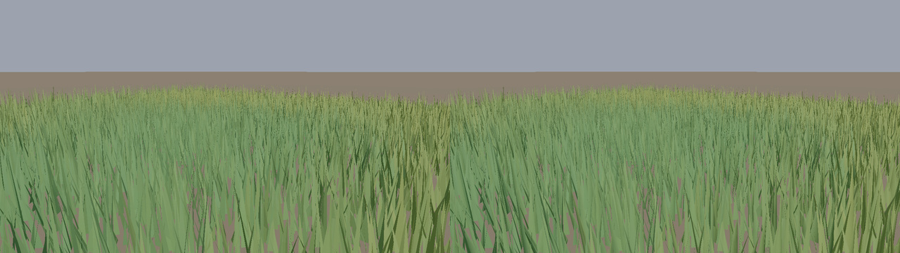

# Rounded blade shading, r62

28 October 2026. The supplied grass tutorial motivates a small source-lighting
experiment: smooth normals along the blade and rounded normals across its width.
The existing meadow already has permanent root jitter, curved ribbons, blade
yaw, base-to-tip pigment, GPU wind and three geometric source LODs.

Sideways selects the experiment with
`SIDEWAYS_PROCEDURAL_GRASS=field` and
`SIDEWAYS_MEADOW_BLADE_SHADING=rounded`. Unset or `flat` retains the existing
source. Invalid values fail construction. This is an opt-in visual change;
the saved vegetation preset and GameNight registration are not changed.

Warp cooks the normals from the source ribbon frame, after selecting each
geometric cut. Shared source positions receive the same normal at every LOD.
Triangle interiors still interpolate differently when stations are removed.
The generic ribbon simplifier keeps its existing geometric-normal contract.
Triangles, blade widths, roots, bounds, colours, roughness and wind are
unchanged. No per-frame shader work, new texture or render pass is added.
The distant atlas is rebuilt from the same cooked source normals.

This changes shading, not the physical shape of a blade. Source raster and
visibility shading retain geometric face normals for shadow bias. The distant
aggregate still uses its existing resolved shading normal as an approximation
for geometric bias; rounded shading does not repair that limitation. Wind
remains the existing four angle groups, without new flutter or Perlin noise.
Camera-facing thickening and new self-shadow/AO are outside this patch.

The launcher records the selected mode. F12 metadata includes it and replay
rejects a mismatched mode; older captures without the field mean `flat`.

## Validation and evidence

`cargo check --locked --workspace`, renderer library tests (535 passed, one
ignored), CLI tests, capture-replay tests, and `test-play-dev.ps1` passed.
The renderer tests cover all 120/180/360 budgets, fixed twenty-degree edge
angles after anisotropic placement, unchanged geometry/LOD bounds, matching
station normals across cuts, and unchanged atlas coverage/material/positions
and voxel geometric normals/areas. Existing dead-code warnings remain.

The `meadow_shading_gpu` release example rendered eight matched flat/rounded
pairs on an NVIDIA GeForce RTX 5070 Ti/Vulkan: native 1280×720, one camera,
120 blades per patch, seed 73, wind strength 0.8 at fixed times 0 and 2 seconds.
It covers close, coarse source, source/aggregate handoff, and aggregate-only
views. Three settling frames precede each captured result. Actual source alpha
bits and selected draw counts match in all eight pairs. The close view selects
22/62/92 patches across its three LODs; the coarse view selects 256 LOD2
patches. Handoff selects 256 source and 256 aggregate patches; distant selects
only 256 aggregate patches. These are tiny diagnostic habitats, not a forest
performance measurement. Source depth is not exposed by this fixture API.



Close-image review shows softer transverse shading on the broad blades, with
the same angular silhouettes and visible ground gaps. The improvement is
subtle; this is not a dense meadow or self-shadowing overhaul. An initial
backlit fixture was also retained; the comparison above uses camera-side
raking light and EV100 13 in both halves to make the normal response readable.
Far patches occupy few pixels here, so the stills do not establish transition
quality during movement.

The real Sideways scene also completed serial A/B runs of
[`rounded-grass.toml`](../../games/sideways/scenarios/rounded-grass.toml), with
two fixed cameras, 24 frames each, native 1920×1080, one view, 120 blades and
the saved vegetation baseline. Both logs confirm their selected shading mode
and the 25–35 m source band. PNGs show the effect is subdued in the shaded
roadside view; the overview remains dominated by trees. No new missing grass
was apparent in these stills. This does not prove exact scene parity, live
motion, DLSS, all-weather quality or four-player performance. The short scene
run has no valid steady GPU samples; no timing improvement is claimed.

Evidence root: `C:/dev/perf/warp-sideways-20261028/r62-rounded-grass/`.
`fixture-lit/report.json` records all GPU pairs; `game-flat/` and
`game-rounded/` contain the actual scene captures, launch environments and
executable identity. Both bounded runs exited; no interactive game was started.

Frozen native game: `sideways-r62-native.exe`, SHA256
`eb977caeecc444d2f6d9a6b0cf8ab90f6b4ce4cb1125d44e423b840e38a00cd5`.
Final diagnostic: `meadow-shading-r62.exe`, SHA256
`1db773f84eb5827352f843f4e5bc6d3bee168d45bb617b3ddb1bbd870ae0acd0`.

To reproduce the diagnostic from the workspace root:

```powershell
cargo run --release --locked -p render --example meadow_shading_gpu -- --out C:/temp/new-rounded-grass --aggregate
```

The experiment remains opt-in. GameNight registration and graphics defaults
have not been promoted on the strength of these still-image checks.
