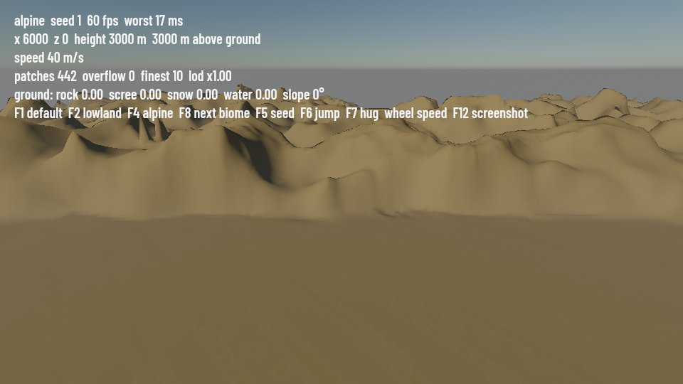

# Terrain regions: one world, several kinds of land

Until now a procedural world had one terrain `Style` everywhere. Regions
(`render::regions`) give each point its own: up to four styles (usually
biomes' `terrain`) and a coarse grid of weights, so a world can run from
alpine massifs into polder with the land changing gradually in between.
This is step 1 of the constrained-generation roadmap (design doc: "Constrained
procedural worlds in Warp").

## How it works

- `Regions` holds the styles and one `u32` per grid node (byte k = weight of
  style k). Default spacing 64 m, so 16 km square is 251 x 251 nodes,
  about 250 KB on the GPU. It is a runtime bake: what a game stores is how it
  painted the weights (a seed and a line, polygons), not the grid.
- `Regions::style_at(x, z)` blends the four surrounding nodes bilinearly,
  normalises, and mixes the styles' 16 floats by those shares. One style at
  full weight gives that style bit for bit, so a world painted with one
  biome is exactly the world without regions.
- `world_constraints` carries the regions: `Constraints { regions, .. }`,
  `World::style_at`, and `World::eval` / `height` / `trees` use the style of
  each point. On the GPU the words follow the cell lists in the existing
  index buffer (no new bindings); `wc_style` in `world_constraints.wgsl` is
  `Regions::style_at` line for line, and `terrain_eval_world` uses it, so
  the procedural terrain mesh follows the regions at every LOD cut.
- `placement::TerrainWorld::style_at` gives the rules the regional style
  (forest share, where things grow, snow line).
- `procedural_terrain::sun_heightfield` takes the constraints, so the baked
  far shadows match the regional land.

Cost per terrain sample: four grid reads and 64 multiply-adds, fixed,
whatever the map's size.

## Try it

```sh
cargo run --release -p app --example terrain_fly -- --style alpine --regions polder
cargo run --release -p app --example terrain_fly -- --style alpine --regions lowland --track
```

`--regions NAME` turns the world into biome NAME east of x = 0, over a 1.5 km
blend along a border that wanders up to 600 m (`Regions::split`).

Seed 1, from 3 km up at x = 6000 looking west (lavapipe software Vulkan,
`--profile low --no-trees`, 960x540). With `--regions polder` the near
half is flat polder and the alpine massifs rise behind the border; without
it the same spot is alpine throughout:




## Validation

- `regions::tests`: one style is that style exactly; a split changes
  gradually and holds its edge past the grid; each side is its own land and
  the blended ground is continuous across the border.
- `world_constraints::tests::regions_shape_the_land_under_the_roads`: a world
  of regions alone, and roads over regions.
- `world_constraints::tests::gpu_matches_cpu` now runs with and without
  regions; `wgsl_validates` checks the composed shaders with naga. Both GPU
  parity tests passed on Mesa lavapipe (software Vulkan) in the cloud
  container; not yet run on a real GPU.

## Not yet regional

- The ground palette (`VegetationStyle`), far forest colour and grass
  colour are still one per world: the polder half keeps the first biome's
  grass and rock colours.
- Flora: species and tree density come from one biome; `forest_field`'s GPU
  copy (`forest_at`) still takes the world style.
- `grass_cells` in `terrain_fly` reads the base style's `grass` amount.
- Sideways and SpaceRacer do not use regions yet.
