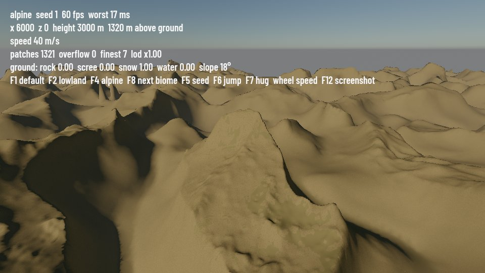

# Terrain regions: one world, several kinds of land

Until now a procedural world had one terrain `Style` everywhere. Regions
(`render::regions`) give each point its own: a palette of up to 256 styles
(usually biomes' `terrain`) and a coarse grid saying which hold where, so a
world can run from alpine massifs through lowland into polder with the land
changing gradually wherever two meet.
This is step 1 of the constrained-generation roadmap (design doc: "Constrained
procedural worlds in Warp").

## How it works

- `Regions` holds the palette and two `u32` per grid node: its four
  strongest styles' ids and their weights, a byte each. What costs per sample
  is how many styles meet at a point (at most four per node), not how many
  the world has. Default spacing 64 m, so 16 km square is 251 x 251 nodes,
  about 500 KB on the GPU. It is a runtime bake: what a game stores is how it
  painted the weights (a seed and a line, a few sites, polygons), not the grid.
- `Regions::style_at(x, z)` mixes the (id, weight) pairs of the four
  surrounding nodes by their weights and bilinear shares. Where only one
  style is present it returns that style bit for bit, so a world painted
  with one biome is exactly the world without regions, and so is the middle
  of every region.
- `Regions::split` paints two lands along a wandering border;
  `Regions::cells` paints any number of lands round sites (a biome map from
  a handful of points); `Regions::paint` takes any weight function.
- `world_constraints` carries the regions: `Constraints { regions, .. }`,
  `World::style_at`, and `World::eval` / `height` / `trees` use the style of
  each point. On the GPU the words follow the cell lists in the existing
  index buffer (no new bindings); `wc_style` in `world_constraints.wgsl` is
  `Regions::style_at` line for line, and `terrain_eval_world` uses it, so
  the procedural terrain mesh follows the regions at every LOD cut.
- `placement::TerrainWorld::style_at` gives the rules the regional style
  (forest share, where things grow, snow line).
- `procedural_terrain::sun_heightfield` takes the constraints, so the baked
  far shadows match the regional land.

Cost per terrain sample: eight grid words, then either one style copied
(inside a region) or at most 16 styles mixed (on a border where four meet),
fixed whatever the map's size or palette.

## Try it

```sh
cargo run --release -p app --example terrain_fly -- --style alpine --regions polder
cargo run --release -p app --example terrain_fly -- --style alpine --regions lowland --track
```

`--regions NAME` turns the world into biome NAME east of x = 0, over a 1.5 km
blend along a border that wanders up to 600 m (`Regions::split`).

Seed 1, from 3 km up at x = 6000 looking west (lavapipe software Vulkan,
`--profile low --no-trees`, 960x540). With `--regions polder` the near
half is flat polder and the alpine massifs rise behind the border; without
it the same spot is alpine throughout:




## Validation

- `regions::tests`: one style is that style exactly; a split changes
  gradually and holds its edge past the grid; each side is its own land and
  the blended ground is continuous across the border; a map of twelve lands
  is each land exactly at its site.
- `world_constraints::tests::regions_shape_the_land_under_the_roads`: a world
  of regions alone, and roads over regions.
- `world_constraints::tests::gpu_matches_cpu` now runs with and without
  regions; `wgsl_validates` checks the composed shaders with naga. Both GPU
  parity tests passed on Mesa lavapipe (software Vulkan) in the cloud
  container; not yet run on a real GPU.

## Not yet regional

- The ground palette (`VegetationStyle`), far forest colour and grass
  colour are still one per world: the polder half keeps the first biome's
  grass and rock colours.
- Flora: species and tree density come from one biome; `forest_field`'s GPU
  copy (`forest_at`) still takes the world style.
- `grass_cells` in `terrain_fly` reads the base style's `grass` amount.
- Sideways and SpaceRacer do not use regions yet.
