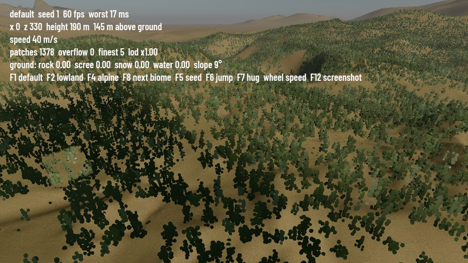
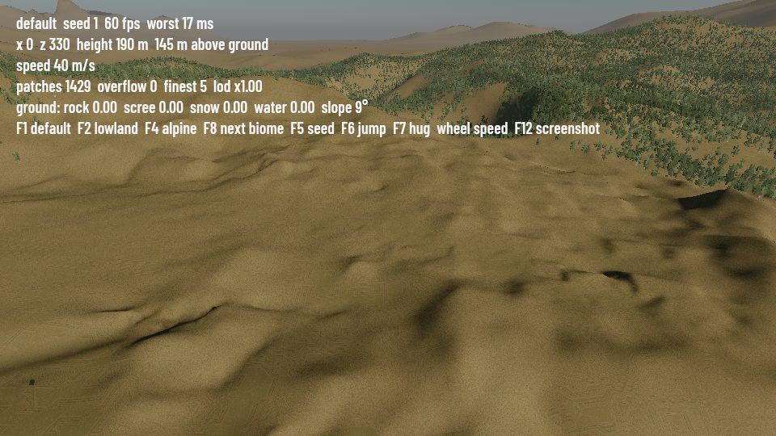
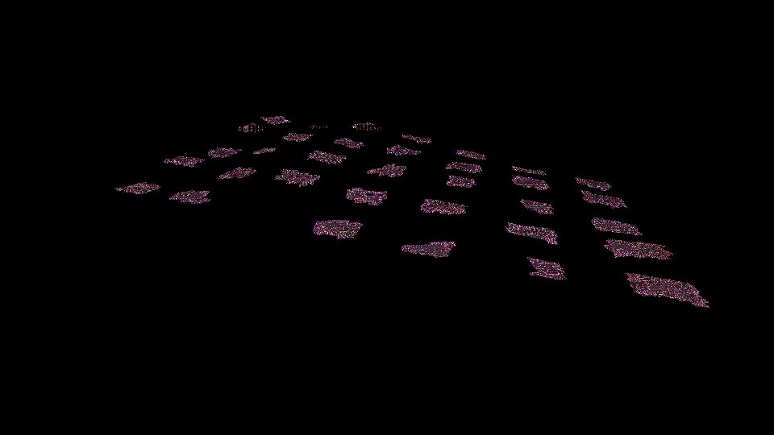

# Zones and footprints: what each place is for, and where things stand

Step 2 of the constrained-generation roadmap (design doc: "Constrained
procedural worlds in Warp"), after [terrain regions](terrain-regions.md).
Regions say what kind of land lies where. Zones say what a place is *for*,
and footprints are the hard plots the land is levelled to. Both live in
`world_constraints`, so a map stays a handful of outlines on disk.

## Footprints (hard intent)

`world_constraints::Footprint` is a flat plot of any outline: a building's
footing, a yard, a square. Inside the outline the ground is level at its
height (by default the land's own height at its centre). Outside, it meets
the land again over the same banks as a road or pad. A pad is the round
case of a footprint.

- `Footprint::rect(centre, size, yaw, feather, height)` for the common case;
  any outline (concave too, either winding) via the struct.
- `.bare(1.0)` makes the plot bare gravel like the road; 0 keeps the land's
  surface.
- Footprints are items in the same coarse cell lists as roads and pads, so
  the terrain mesh, physics height, `clearance` (trees and grass keep off)
  and the GPU (`wc_rim`, `wc_outline`) all see them. Their corners follow
  the region words in the existing index buffer: no new bindings.

## Zones (soft intent)

`zones::Zone` is an outline with a tag ("industrial", "residential", "town",
anything a game names) and soft values: `density`, `wealth`, `age`, each 0..1.
Its edge is feathered: half the feather inside the outline, half outside,
so two zones sharing an edge always sum to one across it.

Zones bend nothing. They are fields that generators read:

- `World::zone(tag, x, z)`: that tag's share at a point.
- `World::zoning(x, z)`: how much is zoned (`covered`) and the zones'
  `density`, `wealth` and `age` there, weighted by their shares.
- Placement fields: `"zone:TAG"`, `"zoned"`, `"density"`, `"wealth"`, `"age"`.
  `placement::thinned(rules, "zone:town")` keeps a rule set out of a zone.
- GPU: `wc_zone(x, z, tag)` and `wc_zoning(x, z)` in
  `world_constraints.wgsl`, line for line the Rust.

A tag is an id, like a region's kind: each system keeps its own table by tag
(a street pattern, a building style, a prop list). Cities and buildings will
read these fields; none of them is built yet.

Zones are baked into their own 64 m grid. Each cell lists the zones that
reach it, and a cell wholly inside a zone is marked so it needs no distance
at all. A sample reads one cell's short list, and on a border it computes
one outline distance per zone there, so the cost does not grow with the
map's size.

## Try it

```sh
cargo run --release -p app --example terrain_fly -- --town
```

`--town` adds a "town" zone of about 900 m round the origin with no forest
in it, and a turned grid of 35 bare 30 x 18 m building plots. Each plot is
levelled at its own land height.

Seed 1, default style, from (0, 190, 330) looking north (lavapipe software
Vulkan, `--profile low`, 960x540). Without zones, then with `--town`:




On this sand the bare plots barely differ in colour from the land. The
amplified difference between the shot with and without bare plots shows all
35 in place:



## Validation

- `zones::tests`:
  - a zone is whole inside and fades at its edge;
  - neighbours hand over (shares sum to one, values change smoothly);
  - the grid finds what testing every zone finds (concave outline, overlaps);
  - outline distance is signed, exact, either winding.
- `world_constraints::tests::a_footprint_is_level_inside_its_outline`
  (a concave L and a turned rectangle; zones bend nothing).
- `world_constraints::tests::gpu_matches_cpu` now also carries footprints
  and three overlapping zones and compares `wc_zoning` and `wc_zone` with
  the CPU; it passed on Mesa lavapipe (software Vulkan), not yet on a real
  GPU. `wgsl_validates` checks the composed shaders with naga.

## Not yet

- The far forest (`forest_at`) and grass ignore zones; only placed objects
  read them.
- Nothing generates buildings or streets from zones yet (roadmap steps 6
  and 7).
- Zones are not regions: a zone can't change the terrain style. Paint a
  region for that.
