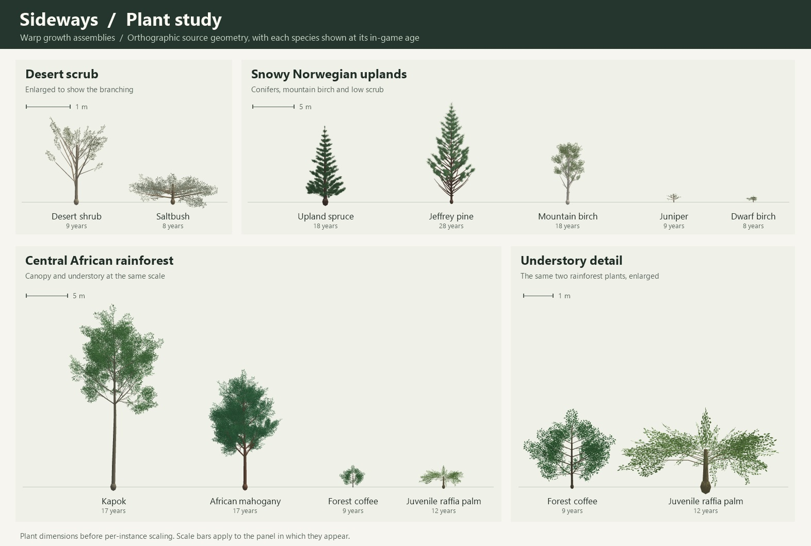

# Procedural terrain

Warp's outdoor worlds are functions, not stored data. The ground, where
trees stand, what grows where and what each place is for are all evaluated
from a position and a seed, on the CPU and on the GPU alike. A world on
disk is a seed, a few settings and the constraints a game or artist fixes
(a road, a plot, an edit). This page describes how the pieces fit together.
The focused guides go deeper:

- [Terrain regions](terrain-regions.md): several kinds of land in one world.
- [Zones and footprints](terrain-zones.md): what each place is for, flat plots.
- [World overrides](world-overrides.md): artist edits on top of rule placement.
- [Shared terrain visibility](terrain-world-visibility.md): first-hit and sky
  queries against the heightfield.
- [Terrain normals](terrain-surface-normals.md) for the older baked
  (Sideways) terrain mesh.

Try it with the debug flight game (all headless options work too):

```sh
cargo run --release -p app --example terrain_fly -- --style alpine --seed 3
cargo run --release -p app --example terrain_fly -- --track              # a road the land bends to
cargo run --release -p app --example terrain_fly -- --style alpine --regions polder
cargo run --release -p app --example terrain_fly -- --town               # zoned plots with buildings
cargo run --release -p app --example terrain_fly -- --bench 120          # headless GPU pass times
```

## The height function

`render::terrain_field` is the terrain: one function from (x, z) to height
plus surface attributes (`Sample`: rock, scree, wetness, water depth,
water film, moor, snow). It
has two copies that must stay line for line identical:

| Copy | Used for |
| --- | --- |
| `render/src/terrain_field.rs` | Physics and collision, LOD error bounds, baking, placement, tests. Uses only basic IEEE operations, so it is bit-exact on every CPU. |
| `render/src/shaders/terrain_field.wgsl` | Building the visible mesh on the GPU. Agrees with the CPU to within float rounding. |

Check parity after any change, one style at a time (the full suite reports
false mismatches):

```sh
cargo run --release -p render --example procedural_terrain -- --dump --only NAME
```

A `terrain_field::Style` sets the shape (lowland, alpine, polder and so on).
`render::biome` wraps a style with a vegetation palette and growth amounts
as data, and `biome::Environment` adds the season and hour (palette shift,
seasonal snow, sun position).

## Biome presets

The flight demo starts in the Swiss Alps. Pass `--style NAME` or press F6
to change biome. Omit the species overrides to see the biome's own trees
and shrubs. Sideways reads the same presets with `--biome NAME`.
To compare landscapes from a saved F4 view, pass `--style NAME --from FILE`.
This keeps the camera's horizontal position, height above ground and heading.
Use `--from FILE` alone to restore the original world and camera.

| Preset | Ground | Vegetation |
| --- | --- | --- |
| `desert` | Fine dune sand with patches of darker gravel on exposed slopes and dry streambeds | Low silver saltbush and taller twiggy scrub, with open sand between them |
| `norway` | Sheltered snow drifts, soil on exposed shoulders and compacted snow between wheel tracks | Upland spruce with low drooping branches, pine and pale mountain birch, with juniper and dwarf birch below |
| `rainforest` | Rolling Central African lowlands with damp leaf litter and red clay on open ground and tracks | Kapok rises above spreading mahogany crowns. Forest coffee and juvenile raffia palms favor their shade. |



Games can look up `render::biome::Biome::named(name)` and take its terrain,
ground palette and weighted flora together. `Biome::species()` resolves the
recipes in the order used by `Biome::rules()`. A game with its own plant
locations can use `Flora::tree_variant` and `shrub_variant` with a stable
roll at each location. `Flora::shrub_habitat` gives the planting probability
multiplier for the local canopy cover.

The desert, Norway and rainforest species use `plant_growth::grow`. Annual
growth sets the stem, branching, crown and live shoots. Norway uses the
spruce and Jeffrey pine rules and needle brushes from the flight demo.
Broadleaf plants use leafy shoots with stems and individual leaf blades.

`recipe_forest::BiomePlants` cooks each species once into branch source
meshes, branch voxels and a whole-plant voxel pyramid. Pass that catalogue
and the world's plant roots to `foliage_runtime::plant_species_population`.
The GPU selects detail for each view by projected error. Sideways supplies
the plants beside its road and on the distant hills to the same population.

## Mesh: GPU patches by projected error

`render::procedural_terrain` keeps no mesh. Every frame the cameras choose a
quadtree of patches (CDLOD) whose cells project to a few pixels. Each patch
is one 128-triangle cluster in a pool reserved up front
(`procedural_terrain::reserve`); a compute pass samples the WGSL function
into a patch when it first appears, and from then on the patch goes
through the normal cluster pipeline (cull, raster, shade, shadow). All split
screen views share one pool. Surface shading lives in
`shaders/terrain_surface.wgsl`.

## Water at every distance

Ditches, streams and rivers are carved into the height function, but a
coarse patch is too coarse to carve a two-metre ditch. So `terrain_field`
also returns `film`: the share of the cell that is under water at full
detail. A strip thinner than the cell widens to it and thins in proportion,
so the share of water is the same at every LOD (test
`water_keeps_its_share_at_every_cut`). Wet banks blend the same way. Close
to a ditch the surface shader also draws it per pixel (`field_ditch`), so
its edge does not step along triangle edges. Physics, the forest and
placement read the real `water` value and ignore the film.

## Constraints: roads, pads, plots, regions, zones

`render::world_constraints` holds what a game or artist fixes while the
rest stays procedural. Its index buffer is uploaded once and read by the
same function on both sides (`wc_*` in WGSL):

- **Roads.** A race track's road is exactly where and how high the game says;
  the terrain bends to it with cuttings and embankments, rivers stop at it
  and no tree grows on it.
- **Pads and footprints.** Round flat places and flat plots of any outline
  (`Footprint::rect`, `.bare()` for gravel).
- **Regions** (`render::regions`): a palette of up to 256 styles and a 64 m
  grid saying which hold where, blended between up to four per point. One
  style at full weight is bit for bit the single-style world.
- **Zones** (`render::zones`): tagged outlines with soft density, wealth and
  age fields. They bend nothing; placement rules read them.

## What stands where

- **Forest.** `render::forest_field` (with `shaders/forest_field.wgsl`, also
  line for line identical; `gpu_matches_cpu` tests them) says where trees
  grow and what a distant forest looks like, so the far forest drawn into
  the terrain stands exactly where the near trees are. Sample the terrain at
  a cut above 0: `x / 0` in the terrain fade is not portable WGSL.
- **Rule placement.** `render::placement` places objects (trees, boulders,
  trunks, flower patches, buildings) from rules on jittered grids. Each
  object has a stable `id` from its grid cell and seed, the same on every
  machine and for any area asked.
- **Overrides.** `render::overrides` keys artist edits (remove, replace
  with a pinned object, add) on those ids, saved as plain text. CPU only
  for now.

## Light on the land

- Far mountain shadows are baked once per sun direction
  (`procedural_terrain::sun_heightfield` into `Scene::terrain_sun`). Keep
  heightfield heights at the `-1e9` sentinel for procedural terrain: real
  coarse heights black out pixels in GI and transmittance.
- `render::terrain_trace` answers camera-independent visibility queries
  against a min/max hierarchy of the heightfield
  ([shared terrain visibility](terrain-world-visibility.md)).

## Not built yet

GPU placement (with a GPU id table for overrides) is the next step of the
constrained-generation roadmap. The far painted forest and its colour are
still global: they ignore regions, zones and overrides. Sideways and
SpaceRacer do not use regions yet. See [status](status.md) for the latest.
