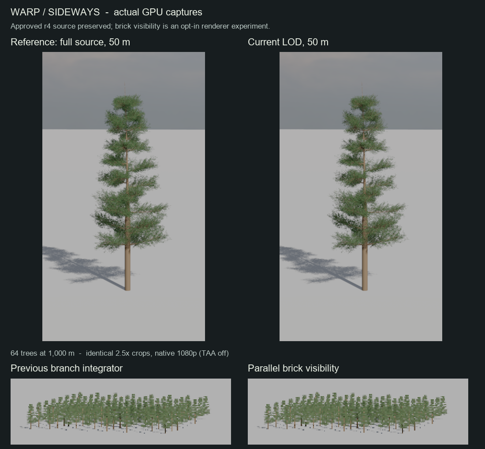

# Vegetation: next-agent hand-off

The user wants a Nanite-inspired architecture: detailed shared twig/leaf
assemblies, GPU pose animation, volume-preserving distant representations,
and scalable lighting/shadows. Preserve the approved r4 spruce geometry.
Compare each architectural choice against [Epic's Nanite Foliage documentation](https://dev.epicgames.com/documentation/en-us/unreal-engine/nanite-foliage).
Distinguish documented mechanisms from our own approximations; do not describe
the current renderer as full Nanite parity.

## Checkout and reproduction

Use an up-to-date checkout of `ontola/warp-game-engine` main. This integration
was prepared in `C:/dev/warp-main-vegetation-20261029`. The old
`C:/dev/warp-sideways-plant-species-20261028` has a broken Git pointer and is
only a preserved source backup. `C:/dev/warp-gg` belongs to other game work;
do not reset, switch, stash or copy over that checkout.

Run from the repository root in PowerShell. These are offscreen GPU fixtures,
not an interactive game. Use a fresh output directory for each run:

```powershell
cargo build --locked -p cli --example vegetation_forest_lod
$env:KERN_VOXEL_BRICK_VISIBILITY = '1'
$env:KERN_DIAGNOSTIC_HIDE = 'none'
cargo run --locked -p cli --example vegetation_forest_lod -- --root games/sideways --out build/vegetation-review-01 --trees 1 --views 1 --distances 50,1000 --width 1920 --height 1080 --warmup 8 --samples 8 --taa 1 --mode both
```

For the 64-tree stress test, use `--trees 64 --views 1 --distances 1000 --taa 0
--mode auto`. For four views use `--trees 4 --views 4` and the same 1920x1080
output (four 960x540 views). Full-source `both` is intentionally limited to
at most four trees. The flag enables the global visibility stream implicitly.
To reproduce the previous branch-stream baseline:

```powershell
$env:KERN_VOXEL_BRICK_VISIBILITY = '0'
$env:KERN_VOXEL_GLOBAL_INTERVALS = '1'
# Run the same fixture with another output directory.
```

Remove these process environment variables when finished. Run GPU fixtures
serially and do not stop unrelated games. Shared Cargo target directories can
be used explicitly for compilation, but never rebuild a fixture executable
while it is running on Windows. Normal Sideways play still uses the retained
forest: the new assembly/aggregate path is opt-in fixture work. Do not enable
the old flattened `SIDEWAYS_TREE_SPECIES=mixed` route.

## What exists

- `plant_recipe.rs`, `plant_spray.rs`, and game `plant_species.rs`: shared
  detailed components and species recipes. The spruce has approximately
  32 million source triangles if expanded, but shares about 1.31 MiB of
  primitive geometry, with 5,169 placements and 61 real wind poses.
- `vegetation_aggregate.rs`: source-derived directional extinction, material
  and normal moments; sampled optical errors against triangle CLOD cuts.
- `aggregate_lod.rs` and its shader: per-view GPU selection and parent/child
  suppression. Source cut/error and volume decisions are distinct.
- `part_wind.rs`: actual branch hierarchy, visibility/motion scheduling,
  attachment pages and temporal history. Do not add fake bones for bricks.
- `voxel_bricks.rs`: immutable shared support bounds and tree/level references.
  Trilinear halos are partitioned into non-overlapping regions.
- `voxel_forest.rs` and its shader: parallel brick projection, bounded interval
  construction, deterministic front-to-back sorting, then fractional material
  and lighting integration. Complete fallback handles admission/pool overflow.

The new visibility stage does not shade. Integration still samples the medium
and evaluates BRDFs repeatedly. Source triangles still cast shadows. Selection
is capped at 4,096 branch groups, and source attachments remain resident per
tree. There is no general virtualized cluster streaming yet.

## Evidence and acceptance limits

See [architecture and measured results](vegetation-brick-visibility.md),
[portable measurements](evidence/brick-visibility-review.json), and the image
below. Raw logs/captures are also preserved locally under
`C:/dev/perf/warp-sideways-20261028/aggregate-lod`.

The pre-integration 64-tree diagnostic measured 85.32 ms for baseline
visibility plus integration versus 21.41 ms for the new path; covered GPU
interval 112.12 versus 49.21 ms. Same geometry/shadow submissions, eight measured
frames after eight warmups, RTX 5070 Ti/Vulkan, uncontrolled background GPU
load. This is not gameplay FPS or proof of the 4K/four-player 8.33 ms target.
The fixture pins both sun maps on the forest, deliberately stressing shadows.

Exported native opacity matches the former integrator at 0.999627 fuzzy IoU.
That does not mean it matches source geometry: at 1,000 m the volume still has
about 12.37% excess coverage. At 50 m the existing source cut loses about 3.44%
coverage. Do not loosen the 0.08 sampled optical threshold to hide these gaps.
Stationary 32-frame TAA captures are not moving-camera/wind/DLSS acceptance.



## Next engine work, in order

1. Separate inexpensive material/normal resolve from repeated lighting work.
   Visibility now costs about 0.64 ms in the 64-tree fixture; integration still
   costs about 20.77 ms. Preserve directional extinction and normal distributions,
   and validate shadowed/backlit views. Do not substitute a constant up-normal,
   change geometry, or remove lighting to manufacture a speedup.
2. Add a voxel shadow consumer with light-space error selection and coverage
   tests. Camera LOD alone leaves 177.6 million submitted shadow triangles in
   that diagnostic. Sharing aggregate data is not itself voxel shadow rendering.
3. Measure source-versus-aggregate error after screen-space filtering. Address
   coverage bias, silhouettes, pop-in and temporal stability over a camera
   distance sweep, multiple sun angles and animated poses. Keep source reference
   captures beside candidates. Avoid stochastic grain without demonstrated
   reconstruction quality.
4. Replace the 64 KiB selection uniform/4,096-group ceiling and reduce per-tree
   placement residency before claiming larger forests. Keep per-view memory
   budgets, overflow counters and complete fallbacks explicit.
5. Integrate into live Sideways only after visual, moving-camera and four-view
   checks. Measure real gameplay shadow scheduling separately from the fixture.

## Checks

```powershell
cargo check --locked --workspace --all-targets
cargo test --locked -p render --lib
cargo test --locked -p cli --bin sideways
cargo test --locked -p render --lib gpu_visibility_sort_and_boundary_ownership -- --ignored --nocapture
games/sideways/tools/test-play-dev.ps1
```

Before integration: 675 render tests passed, 16 ignored; the explicit GPU
oracle passed, including concurrent allocator overflow. Sideways had 189
passing tests and one ignored. Main integration results are recorded in
`engine/HANDOFF.md`; counts may increase with newer main changes. Do not turn
historical test counts into a claim that every ignored GPU test ran.
