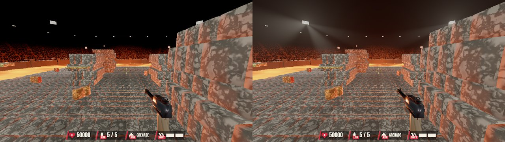

# Volumetric light from local lights

Opt-in single in-scattering from local lights, so a floodlight shows its
beam in the night air and warm lamps (Growing Guns' lava) a haze. Code:
`render::volumetric`, `shaders/volumetric.wgsl`.



## API

- `Lighting::volumetric: Option<Volumetric>`, default `None`.
  `Volumetric { density, color, anisotropy, intensity, extinction, ambient, length }`:
  scattering per metre (also the extinction inside the integral), albedo
  tint, Henyey-Greenstein g, artistic multiplier; then, for indoor fog like
  Godot's (the Game Room lobby):
  - `extinction` (0..1, default 0): the scene behind is multiplied by
    `exp(-extinction * density * distance)`. 0 only adds light.
  - `ambient` (default 0): radiance the medium converges to from light
    arriving from everywhere (ambient or bounce light times albedo, plus
    emission); a ray adds `ambient * (1 - exp(-density * t))`.
  - `length` (default 0, unbounded): metres from the camera the medium
    reaches (Godot's `volumetric_fog_length`).
- `Lighting::set` keys: `volumetric=0|1`, `vol_density`, `vol_anisotropy`,
  `vol_intensity`, `vol_r`, `vol_g`, `vol_b`, `vol_extinction`, `vol_length`.
- `Renderer::set_local_lights_scattering(lights, weights)`: the local
  lights, plus a scatter weight each (missing weights are 0). Surface light
  ignores the weights. `set_local_lights` is the same with no weights.
- `Renderer::set_volumetric_beams(lights)`: lights that only scatter and
  light no surface, e.g. narrow beams inside a wide flood whose surface light
  is one local light.
- At most 32 lights scatter: weighted local lights first, then beams.

## Method

Per pixel and light, the view ray is clipped to the light's range sphere and,
for spots narrower than about 87 degrees, to the outer cone (a quadratic). The
irradiance model is `local_light_sample`'s: cone smoothstep, range fade
`(1 - (d/R)^4)^2`, and `(d^2 + s^2)^(falloff/2)` spread. Inside the source
radius `s` this differs from the surface's `max(d^2, s^2)`, which keeps the
integrand smooth.

The integral is taken in the angle of the closed form, with
`h'^2 = h^2 + s^2` (h: the ray's miss distance):

- for falloff 1.75 and up, `t = tc + h' tan(a)`. For inverse square this is
  the exact atan form;
- for lower falloffs, `t = tc + h' sinh(a)`. This is exact for 1/d, the
  falloff of Growing Guns' floodlights.

What remains (cone, range fade, HG phase and transmittance
`exp(-density (t + d))`) is smooth in `a`. It is integrated with 6-point
Gauss-Legendre. Against 50,000-step quadrature this is within 1% for
omnis, spots, rays through the source and rays starting inside it.

In this (default) mode there is no occlusion term: a beam passes through
walls; the depth buffer only ends the ray at the first surface.

### Bounded, shadowed mode

`Renderer::set_volumetric_bounded(bounds, occluders, sun)` restricts the
medium to up to 8 axis-aligned boxes (rooms) and switches to a ray march
there, with shadows from boxes:

- `bounds`: where the medium is. Outside them nothing scatters.
- `occluders`: unit boxes under transforms (walls, furniture, a door as it
  stands; set them every frame for moving ones). Each bound keeps the list of
  boxes within half a metre of it; a sample tests the segment to every light
  against its own bound's list, so a lamp behind a wall casts no beam in
  front of it and a doorway lets a shaft through.
- `sun`: how much of the sun's irradiance scatters in the bounds, occluded
  the same way (daylight through a door or window).

The march takes 12 steps per pixel at quarter resolution, offset by a fixed
4x4 Bayer pattern; the composite gathers 4x4 of the marched pixels (a tent),
which averages the pattern. Cost at 4K on an RTX 5070 Ti, internal
resolution 3840x2160, the `interior_rooms` example (pendant, four lamps,
about 15 boxes per room): 2.6 ms for both passes, 0 with the fog off. Each
step costs about 0.17 ms. `interior_rooms` (Tab) shows it.

## Passes

The passes run after TAA or DLSS and before effects and sprites. An analytic
integral has no noise to hide, and the passes never write temporal history.

1. `scatter`: half of the internal resolution. Each texel takes the nearest
   or the farthest depth of its 2x2 footprint, in a checkerboard. It stores
   the RGB in-scatter and the linear depth.
2. `composite`: output resolution. It upsamples bilinearly, with each tap
   weighted by `exp(-gap^2)`, where `gap` is the depth difference relative to
   5% of the nearer depth. When every tap is far off, it falls back to the
   nearest-depth tap. It writes `input + scatter` to a separate texture.

With `volumetric: None`, or no light with a weight or beam, the frame does
nothing: no pass, texture or uniform. Growing Guns' goldens and every
day, sunrise, sunset and `godot` capture in `scripts/sky.json` are
byte-identical to the build before this change, and so are the night
captures with `light volumetric=0`. Sideways never sets it. The scene's
extinction stays with the existing distance fog; this pass only adds light.

## Cost

Measured with `cargo test -p render --lib volumetric::tests::gpu_cost --
--ignored --nocapture` on llvmpipe (`KERN_ADAPTER=software`, 2 CPUs, 28
October 2026). The figures are the wall time of both passes per view, at sky
depth (full-length rays, the worst case), with a Growing Guns-like set of
lights: 4 floods (38 degrees, range 80 m), 12 beams and 14 omnis.

| internal size | 1 light | 8 lights | 30 lights |
|---|---|---|---|
| 1280x720  | 53 ms | 60 ms | 154 ms |
| 1920x1080 | 96 ms | 139 ms | 405 ms |

These are CPU-rasteriser numbers, not GPU numbers. On a real GPU I estimate,
without having measured it:

- each fully evaluated light costs about 400 ALU operations per half-res
  texel (6 nodes of tan/sinh, sqrt, pow and exp each);
- for 1080p internal (518k half-res texels) with about 15 lights hit, that is
  about 3 GFLOP, so 0.2-0.4 ms on a 20 TFLOP desktop GPU;
- the composite at 1080p output is about 0.05-0.1 ms;
- a native 4K view is about 4x, so 1-1.5 ms.

Lights whose sphere or cone the ray misses cost a few operations. For
Sideways' four-view budget it should stay off.

## Growing Guns

`sky::volumetric` turns it on once the sun is below the horizon, fading in
down to -6 degrees. Day, sunrise and sunset are unchanged. Density is
0.0003/m in clear air, 2.5x in haze and 5x in mist. The tint is slightly
warm, with g = 0.45.

Scatter weights (`view::Scatter`):

| light | weight | count |
|---|---|---|
| wide floods | 0.2 | 4 |
| scatter-only beams (2.5-6.5 degrees, fanned over the field) | 1 | 3 per bank, 12 |
| lava glows | 1 | up to 14 |
| roof beacons | 0 | |
| pickup ground lights (`pickup_scatter`) | 4 | 1 per pickup |
| pickup drop beams: scatter-only searchlights up from the landing spot (0.6-2.2 degrees) | 4 | 1 per pickup, after the stadium beams |

The drop beam itself is drawn as an additive light-shaft sprite
(`Sprite::shaft`: turned about the vertical towards each camera, a soft
core-and-glow falloff in its texture), so it reads as light in air by day
too; the searchlight adds the scattered haze at night.

The beacons have weight 0 because otherwise the 32-light budget runs out.

Tune live with the `command` tool, for example
`light vol_density=0.0005 vol_anisotropy=0.6 flood_scatter=0.3 lava_scatter=0.5 pickup_scatter=2`.
`light` shows the current values and `light reset` drops them. Overrides
survive sky changes.

## Limits

- Unbounded mode: no occlusion of the air, so no shadows in the beams, and a
  lamp behind a wall still glows in front of it if the ray reaches its
  sphere. The bounded mode has shadows, but only from the boxes it is given,
  not from the shadow maps.
- Bounded mode: 12 steps show as a slight dither on bright beams close to
  the camera (a flashlight).
- Single scattering in a homogeneous medium, with no height falloff.
  Transmittance is approximate. The scene behind is dimmed only with
  `extinction`, by the opaque depth, so a blended surface in front of a wall
  is dimmed as if at the wall.
- Half resolution: thin silhouettes can show a slightly soft haze edge.
  There is no temporal filtering, and none is needed.
- The beams are scatter-only by design. Narrow surface spots would light the
  field unevenly.
- Dark haze gradients can show 1-LSB banding after tonemapping, because
  there is no dither.

## Froxel fog

`Lighting::froxel_fog` (`render::froxel_fog`) is a participating medium in
a camera-aligned grid of 160x90x64 cells (froxels; Wronski 2014, Hillaire
2015), slices spaced exponentially from 0.1 m to `far_m` of view depth. The
game sets density (extinction per metre), albedo, anisotropy and,
optionally, the box the medium fills; nothing else, no fog boxes per light.

```rust
light.froxel_fog = Some(FroxelFog { density: 0.15, albedo: Vec3::splat(0.9), anisotropy: 0.4,
    far_m: 32.0, bounds: None });
```

- `fog_inject` (compiled with shade, so the air is lit as surfaces are), one
  workgroup per column of cells: each cell, at a point jittered across it
  every frame, gets the light scattered towards the camera (Henyey-Greenstein)
  from every clustered light with its shadow (one filtered compare), cookie
  and profile, from the sun through its shadow maps, and the room's ambient
  light (the irradiance volume's two hemispheres, the sky through openings
  included), times the scattering coefficient; and the extinction. It is
  blended with last frame's cell where the point was (reprojected, 0.9 kept).
- Air the camera cannot see does not reach the fog it can: a column skips
  cells behind its farthest visible surface (the least depth in its tile,
  found by the workgroup), and a sample that lies behind the depth buffer at
  its own pixel (above a ceiling, outside a wall, in a column that also shows
  the far side of the room) leaves the cell's history as it is, so the cell
  averages its visible air. Without this a cell straddling a wall took the
  outdoor sky and sun into the room's smoke (a bright band along a ceiling).
- `integrate`: per column, front to back, Hillaire's energy-conserving step;
  shade dims each pixel by the transmittance to its depth and adds the
  in-scattered light, trilinear, before TAA.
- Cost, `interior_rooms`, RTX 5070 Ti, 4K: inject 0.60 ms, integrate under
  0.01 ms. `KERN_FROXEL_FOG=0` turns it off.
- Glass and other blended surfaces (drawn after shade, `transparency.wgsl`)
  read the integrated volume at their own depth (`froxel_fog_at`): a pane
  is dimmed and gets the light scattered in front of it, as an opaque
  surface there would; emissive blends are only dimmed (their in-scattering
  is already in the image behind).
- Reflection probe captures have no grid of their own: shade marches each
  capture ray from the probe to its surface in 16 steps through the same
  medium (`fog_medium`, the light `fog_inject` puts in a cell), offset per
  texel; the capture's prefilter averages the offsets.
