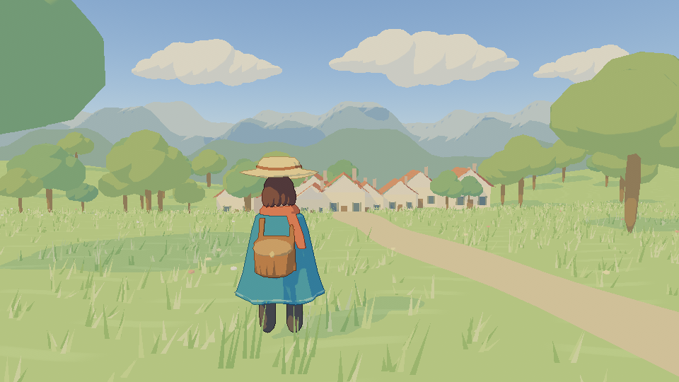

# Painted Meadow



Walk down a summer hillside with a cloaked traveller. The near grass crosses
his ink outline, while the path leads toward a village and distant ridges.

```sh
cargo run --release -p warp -- run games/painted-meadow
```

Move with WASD or the left stick and turn with the mouse or right stick.
The walk is bounded to the near hillside. The village and mountains are scenery.

- [Lighting](lighting.wgsl) sets the palette and light bands. The traveller's
  glTF materials declare a surface kind for each ink group.
- [Image finish](finish.wgsl) draws depth-aware lines on the traveller and
  smooths small patches of background colour. Either shader can be reused
  independently. Reload the game after editing a shader.
- [Scenery](scenery.mjs) generates the two bundled meshes, including the
  grass, buildings, hills, clouds, and the folds and trim of the cloak.
  Run `node games/painted-meadow/scenery.mjs` to regenerate them.
- [Movement](main.luau) owns the traveller's gait and follow camera.

To reproduce the two headless views, run
`warp script games/painted-meadow games/painted-meadow/walk.json --out build/painted`.
